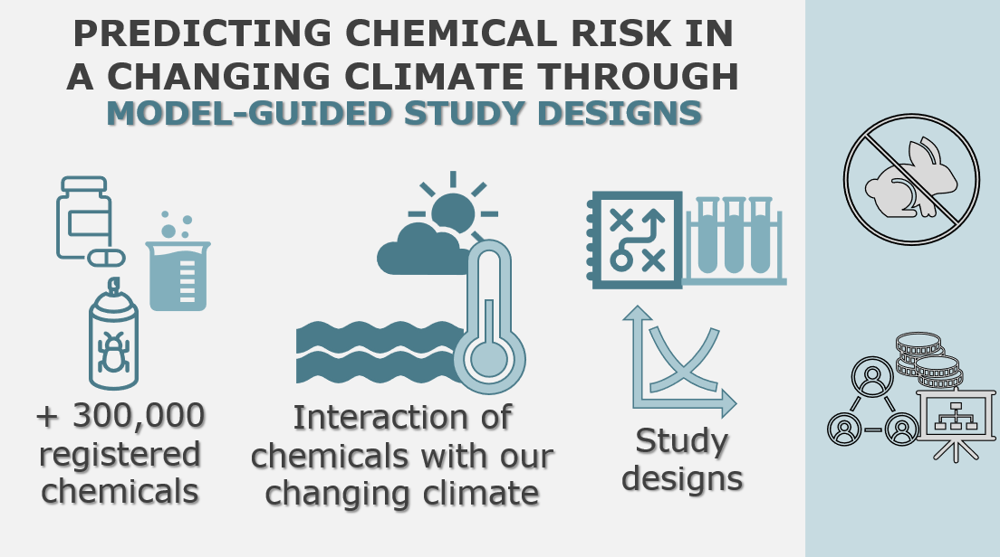
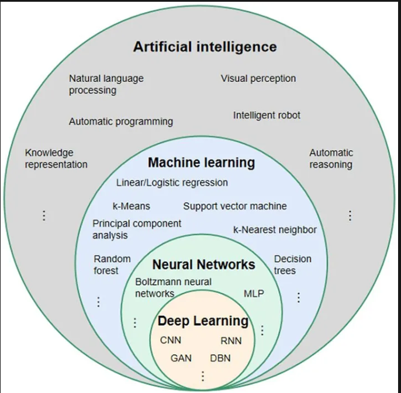
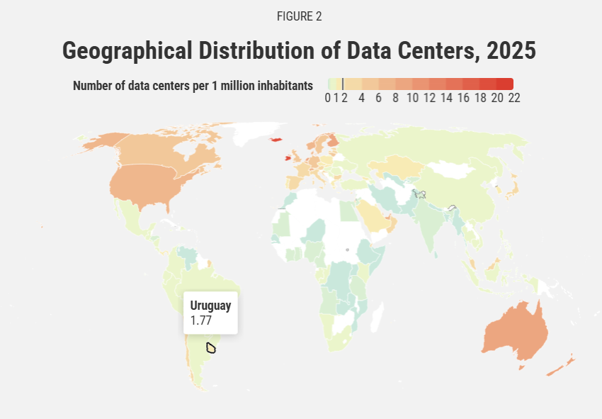
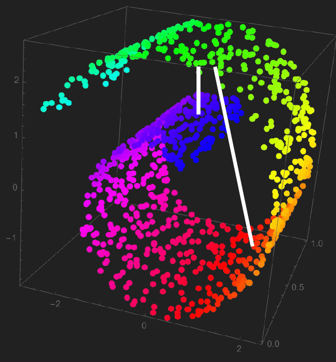

## {background-color="#005a8c"}

::: {.title-slide-wrap}
<h1>Let's Talk About AI</h1>

Epistemology, Foundations &amp; Applied Machine Learning in Ecotoxicology

Restitution of the FRB-CESAB 'AI for Ecologists: A Toolkit' Training — FR BioEEnViS

<strong>Anthony Fow Esteves</strong>

LBBE – UCB Lyon 1 (UMR CNRS 5558) | Ecotox – UR RiverLy (INRAE)

December 16, 2026

:::

::: {.notes}
- **Spoken core (30-sec icebreaker):** Good morning everyone. Before we begin, I want to set expectations honestly—mostly to take the pressure off myself. I am not a computer scientist or an AI specialist; I am a PhD student in ecotoxicology trained in classical statistics and mechanistic modelling. My goal today is not to lecture from above, but to share a structured, critical compass from the FRB-CESAB training I attended thanks to FR BioEEnViS.
- **Callback:** None (opening slide).
- **Bridge:** Instead of starting with definitions, let's see what is already in the room with a quick game.
:::

## Let's Start With a Game... {.smaller}

::: {.flex-row style="align-items: center; margin-top: 25px;"}

::: {.flex-col .flex-2}
<h3 style="font-size: 1.45em; line-height: 1.3; margin-bottom: 20px;">
What is the very first word (or words) that come to mind when someone mentions Artificial Intelligence?
</h3>

::: {.box-grey}
- Go to **slido.com** and enter code **#3791 5273** (or scan the QR code).
- Submit **as many words as you like** — we will capture this baseline map now and revisit it at the end of Part 1.
:::
:::

::: {.flex-col style="align-items: center;"}

:::

:::

::: {.notes}
- **Spoken core:** Switch browser tab (Ctrl+Tab) to Slido Present Mode so everyone watches the word cloud populate live (2–3 min max). Notice what clusters in the center—usually ChatGPT, LLMs, Gemini, chatbots, or models. Do not correct anyone yet; simply point out that this is our room's baseline mental image of AI.
- **Callback:** Tell the audience to hold this visual in mind—we will revisit it directly in Section 1 and again at the end of Part 1.
- **Bridge:** Now let me briefly explain why an ecotoxicology PhD student ended up at an AI training in Montpellier in the first place.
:::

## The BioEEnViS Opportunity {.smaller}

::: {.flex-row style="margin-top: 8px;"}

::: {.flex-col}
::: {.box-teal style="flex: 1; display: flex; flex-direction: column; justify-content: space-between;"}

**PhD Motivation: Bridging the Methodological Gap**

- Early in my thesis, we considered AI to **guide ecotoxicological experimental designs** or extract experimental data.

:::
:::

::: {.flex-col style="flex: 0.10; align-items: center; justify-content: center;"}
<h2 style="margin: 0; color: #6c757d;">→</h2>
:::

::: {.flex-col}
::: {.box-grey style="flex: 1; display: flex; flex-direction: column; justify-content: space-between;"}

**The External Training Resource**

- **FRB-CESAB (Montpellier, June 2026):** [**AI for Ecologists: A Toolkit**](https://ai-ecol.github.io/) — 5-day intensive course (all materials open-access).

:::
:::

:::

::: {.fragment .box-blue style="margin-top: 8px; padding: 9px 16px; font-size: 0.74em;"}
**Local Acknowledgment (independent of the BioEEnViS mobility grant):** Prior to Montpellier, attending [**AI4BioMed**](https://indico.engineering.univ-lyon1.fr/event/29/) in Lyon—mainly organized and promoted by **LBBE members**—introduced key terminology that made the CESAB transition much smoother.
:::

::: {.notes}
- **Spoken core:** Explain briefly that my thesis question differs from standard ecotoxicology AI uses like QSARs or direct toxicity prediction. Because I lacked formal AI training, I applied for an FR BioEEnViS mobility grant to attend the 5-day FRB-CESAB course in Montpellier. Click once to acknowledge AI4BioMed at Lyon 1 (led largely by LBBE colleagues), which gave me my initial vocabulary before going.
- **Callback:** Reinforces Slide 1's positioning—this talk comes from a domain scientist learning how to adopt AI carefully.
- **Bridge:** Let's look at how those five days at CESAB were structured and what I actually brought back.
:::

## The CESAB Experience {.smaller auto-animate="true"}
Four core modules covered during the 5-day [FRB-CESAB program](https://ai-ecol.github.io/):

 

:::: {.r-hstack style="gap: 18px; margin-top: 22px;"}
::: {data-id="card1" class="box-grey" style="width: 285px; height: 270px; display: flex; flex-direction: column; justify-content: center; text-align: center; font-size: 0.92em; padding: 18px;"}
**Module 1**  
Introduction to AI, History &amp; Machine Learning Foundations
:::

::: {data-id="card2" class="box-grey" style="width: 285px; height: 270px; display: flex; flex-direction: column; justify-content: center; text-align: center; font-size: 0.92em; padding: 18px;"}
**Module 2**  
Introduction to Deep Learning &amp; Neural Architectures
:::

::: {data-id="card3" class="box-grey" style="width: 285px; height: 270px; display: flex; flex-direction: column; justify-content: center; text-align: center; font-size: 0.92em; padding: 18px;"}
**Module 3**  
Applied Deep Learning *(Species Distribution Models &amp; LLMs)*
:::

::: {data-id="card4" class="box-grey" style="width: 285px; height: 270px; display: flex; flex-direction: column; justify-content: center; text-align: center; font-size: 0.92em; padding: 18px;"}
**Module 4**  
Symbolic AI &amp; Constraint-Based Reasoning
:::
::::

::: {.notes}
- **Spoken core (30 sec):** The syllabus spanned four distinct pillars—from ML foundations and neural architectures to applied deep learning (SDMs and LLMs) and symbolic constraint reasoning. Obviously, I cannot compress five intensive days into 45 minutes.
- **Callback:** Connects directly to the CESAB website shown on Slide 3.
- **Bridge:** What mattered most to me was the single pedagogical goal tying all four modules together.
:::

## The CESAB Experience {.smaller auto-animate="true"}
All four modules converge on a single pedagogical objective:

 

:::: {.r-stack style="margin-top: 30px;"}
::: {data-id="card1" class="box-grey" style="width: 780px; height: 250px; border-radius: 10px; opacity: 0.25;"}
:::

::: {data-id="card2" class="box-grey" style="width: 760px; height: 240px; border-radius: 10px; opacity: 0.25;"}
:::

::: {data-id="card3" class="box-grey" style="width: 740px; height: 230px; border-radius: 10px; opacity: 0.25;"}
:::

::: {data-id="card4" class="box-red" style="width: 740px; height: 220px; border-radius: 10px; display: flex; flex-direction: column; justify-content: center; text-align: center; padding: 24px;"}
Official Course Objective — [ai-ecol.github.io](https://ai-ecol.github.io/) 
"Give participants the **autonomy** to assess which algorithms are most adapted to their own research questions, where to find them, and how to adjust them to the desired question."
:::
::::

::: {.notes}
- **Spoken core (30 sec — intentional visual breather):** Pause for two seconds on the word *autonomy*. The course was not about teaching us how to code the trendiest neural network; it was about knowing *when* an algorithm fits your scientific question—and when it does not.
- **Callback:** Converges the four modules from Slide 4 into one guiding principle.
- **Bridge:** Here is how I translated that objective into four core insights that form our roadmap for today.
:::

## The CESAB Experience {.smaller auto-animate="true"}

::: {data-id="card4" class="box-red" style="padding: 10px 18px; margin-bottom: 14px; font-size: 0.80em; text-align: center;"}
Autonomy to assess which algorithms fit your research question ([ai-ecol.github.io](https://ai-ecol.github.io/)) $\rightarrow$ **Translated into 4 Core Insights (Today's Roadmap)**
:::

::: {.flex-row}
::: {.flex-col}
::: {.fragment fragment-index="1" .box-teal}
**Insight 1 · AI > Generative Chatbots** 
[*Section 1*](#/sec-1): Distinguish GenAI from the wider AI taxonomy (ML, DL, Symbolic AI) and examine cognitive &amp; material guardrails.
:::

::: {.fragment fragment-index="2" .box-teal}
**Insight 2 · Domain Baseline Primes** 
[*Section 2*](#/sec-2): Your scientific (e.g., ecological) knowledge anchors plausibility and dictates how a problem is framed.
:::
:::

::: {.flex-col}
::: {.fragment fragment-index="2" .box-teal}
**Insight 3 · Exhaust Traditional Methods** 
[*Section 2*](#/sec-2): Verify dimensionality and exhaust classical statistical analyses as a first step.
:::

::: {.fragment fragment-index="3" .box-teal}
**Insight 4 · Explicit Trade-Offs** 
[*Section 3*](#/sec-3): Balance predictive gain against explainability based on the scientific goal.
:::
:::
:::

::: {.fragment fragment-index="4"}

<em>Note: This session is a curated synthesis of CESAB Day 1 principles — not a 5-day syllabus dump. <a href="02_technical_workshop.html" target="_blank">Session 2 (10:45 a.m.)</a> shows how these insights landed in my PhD.</em>

:::

::: {.notes}
- **Spoken core:** Walk through the roadmap in 4 clicks: (Click 1) Section 1 unpacks Insight 1—first mapping the AI umbrella (1a), then examining cognitive and ecological guardrails around GenAI (1b). (Click 2) Section 2 combines Insights 2 and 3—your domain baseline and exhausting classical methods before scaling up. (Click 3) Section 3 addresses Insight 4—the prediction vs. explainability trade-off. (Click 4) Clarify that Part 1 is a curated conceptual compass, while Session 2 at 10:45 applies it directly to my PhD.
- **Callback:** Directly operationalizes the CESAB autonomy quote from Slide 5.
- **Bridge:** Let's start right away with Section 1 and unpack what sits underneath the AI umbrella.
:::

# Section 1: AI is an Umbrella Term {#sec-1 background-color="#005a8c"}
Insight 1a — Moving beyond chatbots to map the algorithmic toolkit

::: {.notes}
- **Spoken core (15 sec):** Section 1 starts with Insight 1a: widening our view from chatbots to the full spectrum of methods under the AI umbrella.
- **Callback:** Directly challenges the chatbot-heavy cluster we usually see in Slide 2's word cloud.
- **Bridge:** Before I show you a clean taxonomy, let's test how confusing the public diagrams actually are.
:::

## AI is Not a Monolith — It's an Umbrella Term {.smaller}
**Quick Poll (Slido 2):** Which of these four diagrams correctly organises Artificial Intelligence?

::: {.flex-row style="margin-top: 6px;"}

::: {.flex-col .flex-2 style="gap: 10px;"}
::: {.flex-row style="gap: 12px;"}

A. Nested Algorithms

B. AI / ML / DL / NLP / LLM

:::

::: {.flex-row style="gap: 12px;"}

C. AI / Data Science / Big Data

D. CS / AI / Data Science / Math

:::
:::

::: {.flex-col style="justify-content: space-between; gap: 10px;"}

Slido 2 — Code: #3791 5273

::: {.fragment .box-teal style="margin-bottom: 0; font-size: 0.76em;"}
**Answer: All four are partial lenses.** 
There is no single formal definition of AI—each diagram highlights a different disciplinary cut (algorithms, language, data, or math).
:::
:::

:::

::: {.notes}
- **Spoken core:** Switch tab to Slido Poll 2 (Multiple Choice, ~1 min). Ask participants to pick A, B, C, or D. Once votes come in, return and click to reveal the teal box: all four are partial lenses—as CESAB Day 1 emphasized, there is no single formal consensus definition of AI.
- **Callback:** Notice how different this already looks from the single-word associations on Slide 2.
- **Bridge:** Let's take the buzzwords we actually run into in papers and meetings and organize them cleanly.
:::

## Navigating the AI Vocabulary {.smaller auto-animate="true"}
In practice, researchers encounter a scattered soup of overlapping terms and tools:

 

::: {.bubble-cloud}
Linear &amp; Logistic Regression
ChatGPT / Claude / Perplexity
Symbolic Logic &amp; Rules
PCA / UMAP
CNN &amp; RNN
Data Science &amp; Statistics
Random Forest &amp; Decision Trees
Intelligent Robots
Neural Networks (MLP)
Support Vector Machines (SVM)
Knowledge Representation
:::

Which field contains which—and where do everyday chatbots actually sit?

::: {.notes}
- **Spoken core (20 sec):** When you start reading AI literature as a domain researcher, you run straight into this wall of overlapping terms—regressions, PCA, random forests, CNNs, symbolic rules, and chatbots all thrown into the same conversation.
- **Callback:** Connects the four messy Venn diagrams on Slide 8 to the concrete tools researchers encounter.
- **Bridge:** Let's sort these pills into their actual nested structure.
:::

## Navigating the AI Vocabulary {.smaller auto-animate="true"}
Organizing the umbrella into parallel domains and nested subsets:

::: {.nest-ai style="margin-top: 4px;"}
ARTIFICIAL INTELLIGENCE (Umbrella Discipline)

::: {.flex-row style="gap: 14px;"}

::: {.flex-col}
::: {.box-grey style="height: 100%; margin-bottom: 0;"}
Symbolic AI, Reasoning &amp; Embodied Systems

Symbolic Logic &amp; Rules
Knowledge Representation
Intelligent Robots

Explicit rules, ontologies, and constraint solving (e.g., protected-area design in CESAB Day 5).

Overlapping Quantitative Pillar
Data Science &amp; Statistics

:::
:::

::: {.flex-col .flex-2}
::: {.nest-ml}
MACHINE LEARNING (Automated Learning from Data)

Linear &amp; Logistic Regression
PCA / UMAP
Support Vector Machines (SVM)
Random Forest &amp; Decision Trees

::: {.nest-dl}
DEEP LEARNING (Multi-Layer Neural Networks)

Neural Networks (MLP)
CNN &amp; RNN

::: {.nest-gen}
GENERATIVE AI &amp; LLMs (A small, highly visible subset)
ChatGPT / Claude / Perplexity
:::
:::
:::
:::

:::
:::

**Standard reference taxonomy:** The [OECD Framework for the Classification of AI Systems](https://oecd.ai/en/classification) classifies systems by model type (*symbolic, statistical, or hybrid*), learning paradigm, and transparency.

::: {.notes}
- **Spoken core:** Point directly to the small red box at the bottom right (GenAI / LLMs). Reconnect explicitly to Slide 2's word cloud: GenAI dominates our mental picture not because it *is* all of AI, but because of **accessibility**—anyone can ask a chatbot for a dinner recipe, whereas very few people will train a CNN or build a constraint solver. Be candid: AI capabilities are advancing rapidly and producing real scientific breakthroughs (like AlphaFold), so denying its utility makes no sense.
- **Callback:** Closes the loop on Slide 2's word cloud bias and sets up the taxonomy needed to understand where neural networks and LLMs live.
- **Bridge:** And this leads directly to a personal misconception—and a paradox—that hit close to home for me when I began learning these methods...
:::

## A Personal Misconception &amp; The Bio-Inspired Paradox {.smaller}
*When I started learning ML, I assumed neural networks worked like my brain processing thoughts.*

Inspired by biology — <u>not</u> biologically grounded <em>(like a movie "based on true events")</em>

::: {.flex-row style="margin-top: 4px;"}

::: {.flex-col}
::: {.box-grey style="flex: 1; display: flex; flex-direction: column; justify-content: space-between; margin-bottom: 0;"}

**Biological Brain**

- ~**20 W** power budget; slow electrochemical ionic spikes.
- Diverse chemical neurotransmitters &amp; **local synaptic plasticity**.
- Learns flexibly and generalizes from few exposures.

**[IMAGE: Biological Brain / Synaptic Network]** 
Save file as: <code>assets/images/bio_brain_network.png</code>
<!-- {style="max-height: 145px; object-fit: contain;"} -->

:::
:::

::: {.flex-col}
::: {.box-teal style="flex: 1; display: flex; flex-direction: column; justify-content: space-between; margin-bottom: 0;"}

**Artificial Neural Networks**

- Matrix multiplications over floating-point weights.
- **Global backpropagation** optimizing a mathematical loss function.
- Requires massive datasets and computational energy.

**[IMAGE: Artificial Neural Network / Perceptron Layers]** 
Save file as: <code>assets/images/ann_perceptron_layers.png</code>
<!-- {style="max-height: 145px; object-fit: contain;"} -->

:::
:::

:::

::: {.fragment .box-red style="margin-top: 10px; text-align: center; margin-bottom: 4px;"}
**The Paradox:** Tools loosely inspired by human cognition are increasingly used in ways that **short-circuit the very biological process our brains need to learn**.
:::

::: {.ref-footer}
Conceptual inspiration: A. Andalman ([The Deep View, 2025](https://www.youtube.com/watch?v=6b4KPGtu9c0)) · C. Simon ([AI Neuro Insight, 2025](https://www.youtube.com/watch?v=I6PC8f8GRtU)) · A. Karpathy ([Dwarkesh Clips, 2025](https://www.youtube.com/watch?v=wkCx2Xmi8dg)) · AlphaFold ([Nobel Prize in Chemistry, 2024](https://www.nobelprize.org/prizes/chemistry/2024/press-release/))
:::

::: {.notes}
- **Spoken core:** Use my own initial misconception as a teaching moment: coming from biology, I first imagined artificial neurons as miniature reasoning units. In reality, biological brains run on ~20 watts with slow chemical signaling and local learning rules, whereas ANNs do fast matrix algebra and global backpropagation—they share inspiration, not mechanism. Click to reveal the paradox: these bio-inspired tools are now routinely used in ways that bypass our own biological learning.
- **Callback:** Connects directly to the Deep Learning & GenAI nested boxes we just mapped on Slide 10.
- **Bridge:** Let's look closely at how that cognitive shortcut works in everyday research practice.
:::

## Insight 1b: Cognitive Bypassing &amp; Expertise Asymmetry {.smaller}

<svg viewBox="0 0 1160 215" style="width: 100%; height: 215px; display: block;">
  <defs>
    <marker id="arrow-teal" viewBox="0 0 10 10" refX="8" refY="5" markerWidth="7" markerHeight="7" orient="auto-start-reverse">
      <path d="M 0 1 L 10 5 L 0 9 z" fill="#00a3a6"/>
    </marker>
  </defs>
  <rect x="10" y="12" width="235" height="74" rx="8" fill="#f1f3f5" stroke="#6c757d" stroke-width="2.2"/>
  <text x="127" y="44" text-anchor="middle" font-family="Space Grotesk, sans-serif" font-size="19" font-weight="700" fill="#212529">Raw Information</text>
  <text x="127" y="68" text-anchor="middle" font-family="Inter, sans-serif" font-size="14" fill="#495057">Papers · Data · Code</text>
  <line x1="245" y1="49" x2="312" y2="49" stroke="#00a3a6" stroke-width="3.5" marker-end="url(#arrow-teal)"/>
  <rect x="322" y="12" width="445" height="74" rx="8" fill="#e6f6f6" stroke="#00a3a6" stroke-width="2.5"/>
  <text x="544" y="44" text-anchor="middle" font-family="Space Grotesk, sans-serif" font-size="19" font-weight="700" fill="#005a5c">Effortful Processing</text>
  <text x="544" y="68" text-anchor="middle" font-family="Inter, sans-serif" font-size="14" fill="#004d50">Cognitive Friction &amp; Schema Building</text>
  <line x1="767" y1="49" x2="834" y2="49" stroke="#00a3a6" stroke-width="3.5" marker-end="url(#arrow-teal)"/>
  <rect x="844" y="12" width="306" height="74" rx="8" fill="#d3f2f2" stroke="#006f7a" stroke-width="2.5"/>
  <text x="997" y="44" text-anchor="middle" font-family="Space Grotesk, sans-serif" font-size="19" font-weight="700" fill="#004d50">Durable Expertise</text>
  <text x="997" y="68" text-anchor="middle" font-family="Inter, sans-serif" font-size="14" fill="#004d50">&amp; Critical Audit Capacity</text>
</svg>
<svg class="fragment" viewBox="0 0 1160 215" style="width: 100%; height: 215px; display: block;">
  <defs>
    <marker id="arrow-red" viewBox="0 0 10 10" refX="8" refY="5" markerWidth="7" markerHeight="7" orient="auto-start-reverse">
      <path d="M 0 1 L 10 5 L 0 9 z" fill="#e53935"/>
    </marker>
  </defs>
  <path d="M 127 86 L 127 166 L 834 166" fill="none" stroke="#e53935" stroke-width="3.5" stroke-dasharray="8 5" marker-end="url(#arrow-red)"/>
  <rect x="335" y="143" width="415" height="28" rx="6" fill="#fdf0f0" stroke="#e53935" stroke-width="1.5"/>
  <text x="542" y="162" text-anchor="middle" font-family="Inter, sans-serif" font-size="14.5" font-weight="700" fill="#8c1d18">GenAI Shortcut — Bypasses Effortful Processing</text>
  <rect x="844" y="129" width="306" height="74" rx="8" fill="#fdf0f0" stroke="#e53935" stroke-width="2.5"/>
  <text x="997" y="161" text-anchor="middle" font-family="Space Grotesk, sans-serif" font-size="19" font-weight="700" fill="#8c1d18">Illusion of Learning</text>
  <text x="997" y="185" text-anchor="middle" font-family="Inter, sans-serif" font-size="14" fill="#8c1d18">&amp; Cognitive Debt</text>
</svg>

::: {.fragment .flex-row style="margin-top: 2px; gap: 16px;"}

::: {.flex-col}
::: {.box-blue style="height: 100%; margin-bottom: 0; font-size: 0.77em;"}
**How LLMs Actually Operate**

- LLMs are **probabilistic next-token generators** optimized for fluency—not truth-verification engines.
- Externalizing core analysis risks *cognitive proletarianization* (Stiegler, 2010): fluent outputs can mask weak epistemic grounding and reduce retention, critical thinking, and neural engagement.
:::
:::

::: {.flex-col style="gap: 8px;"}
::: {.box-teal style="margin-bottom: 0; padding: 10px 14px; font-size: 0.75em;"}
**High Domain Background (Your Field):** You form concrete hypotheses $\rightarrow$ write precise prompts $\rightarrow$ **audit and catch errors**.
:::

::: {.box-red style="margin-bottom: 0; padding: 10px 14px; font-size: 0.75em;"}
**Low Domain Background (Unfamiliar Field):** Unclear what to ask $\rightarrow$ vague prompts $\rightarrow$ **plausible errors go undetected**.
:::
:::

:::

::: {.ref-footer}
Stiegler (2010) *For a New Critique of Political Economy* · Messeri &amp; Crockett (2024) *Nature* [10.1038/s41586-024-07146-0](https://doi.org/10.1038/s41586-024-07146-0) · Barcaui (2025) *SSHO* [10.1016/j.ssaho.2025.102287](https://doi.org/10.1016/j.ssaho.2025.102287) · Gerlich (2025) *Societies* [10.3390/soc15010006](https://doi.org/10.3390/soc15010006) · Kosmyna et al. (2025) [*arXiv:2506.08872* (preprint)](https://arxiv.org/abs/2506.08872) · Diagram adapted from [J. Sung (2025)](https://www.youtube.com/watch?v=6sJ50Ybp44I)
:::

::: {.notes}
- **Spoken core:** Walk through the SVG first (Click 1 reveals the red shortcut): biological learning requires the middle step—cognitive friction—to build mental schemas and expertise. Skipping that step does *not* land on expertise faster; it lands on an illusion of learning and cognitive debt (supported by controlled studies: Barcaui 2025, Gerlich 2025, Kosmyna et al. 2025 arXiv preprint). Click 2 for the 30-second rhetorical thought experiment: imagine an ecotoxicologist asking an LLM about survival-model assumptions—they catch a subtle mistake instantly. Now imagine the same person asking it to write an unfamiliar microbial metagenomics or bioinformatics pipeline—it will return fluent, plausible code whose hidden flaws they cannot audit. Practical guardrail: keep cognitive friction for reasoning, writing, and analysis; delegate routine formatting or syntax lookup.
- **Callback:** Directly operationalizes the bio-inspired paradox from Slide 11.
- **Bridge:** Cognitive cost is only half the picture—there is also a physical cost behind every query.
:::

## Beyond Cognition: Material &amp; Ecological Footprint {.smaller}
A brief factual check on the infrastructure behind large-scale AI workflows:

::: {.flex-row style="margin-top: 10px;"}

::: {.flex-col}
::: {.box-grey style="flex: 1; display: flex; flex-direction: column; justify-content: center;"}
**Energy &amp; Resource Rebound**

- **Net $\text{CO}_2$ Rebound:** Global energy–economy modelling indicates that AI-driven productivity gains can enable *more* $\text{CO}_2$ emissions than they avoid (Alpine et al., 2026).
- **Local Water Competition:** Rapid data-center expansion concentrates in regions with unresolved water-access pressures—for example, **Uruguay (1.77)** and **Chile (3.49)** data centers per 1 million inhabitants ([IFC, 2026](https://www.ifc.org/en/insights-reports/2026/risks-and-opportunities-in-data-center-and-ai-investment-in-ems#group-section-Fig-2-K8AjwpCMpV)).
- **Takeaway for Scientists:** Proportionality matters—do not deploy heavy generative or deep-learning compute where a lightweight statistical model already answers the question.
:::
:::

::: {.flex-col style="gap: 10px;"}

"Only a tiny proportion of water in Uruguay is used for human consumption." — Daniel Pena, University of the Republic ([Rest of World, 2026](https://restofworld.org/2026/ai-datacenters-water-resistance-global/))

:::

:::

::: {.ref-footer}
Alpine et al. (2026) *npj Clim. Action* 5, 71 [10.1038/s44168-026-00411-0](https://doi.org/10.1038/s44168-026-00411-0) · International Finance Corporation ([IFC, 2026](https://www.ifc.org/en/insights-reports/2026/risks-and-opportunities-in-data-center-and-ai-investment-in-ems#group-section-Fig-2-K8AjwpCMpV)) · [Rest of World (2026)](https://restofworld.org/2026/ai-datacenters-water-resistance-global/)
:::

::: {.notes}
- **Spoken core (1 min — sober, factual tone):** Keep this grounded and non-alarmist. Beyond cognition, AI has a real physical footprint: global models suggest rebound effects can raise net emissions (Alpine et al., 2026), and data-center placement increasingly intersects with local water stress, as seen in South America (Uruguay at 1.77 and Chile at 3.49 data centers per million inhabitants). As environmental scientists, proportionality is simply good practice.
- **Callback:** Completes Insight 1 (both 1a taxonomy and 1b cognitive + material guardrails).
- **Bridge:** Now that we know what sits under the AI umbrella—and the cognitive and material costs of using it blindly—how do we decide *when* a scientific problem genuinely justifies moving beyond classical statistics?
:::

# Section 2: From Your Research Question to the Right Tool {#sec-2 background-color="#005a8c"}
Insights 2 &amp; 3 — Domain baseline, dimensionality, and exhausting classical methods

::: {.notes}
- **Spoken core (15 sec):** Section 2 brings together Insights 2 and 3: letting your domain question and data structure—not hype—decide which tool across the AI umbrella you actually need.
- **Callback:** Directly connects the expertise-first principle from Slide 12 to practical modelling decisions.
- **Bridge:** Let's ground this in a concrete environmental dataset.
:::

## When Does a Research Problem Need AI? {.smaller}
*Scenario:* Monitoring **100 river sites** across temperature, water chemistry, pollutants, and species communities.

::: {.flex-row style="margin-top: 8px;"}

::: {.flex-col}
::: {.box-grey}
**What Is a "Dimension"?**

- **In Ecology / Env. Science:** Usually 3D physical space $(x, y, z)$ + time.
- **In Data Science / ML:** **Every measured variable is an axis ($d$).** Fifty measured variables place each river site in a 50-dimensional space.
:::

::: {.fragment .box-red style="margin-bottom: 0;"}
**The Curse of High Dimensionality ($n = 100$ sites)**

  
<strong>1D</strong>Temp

  
→

  
<strong>3D</strong>+ pH, O2

  
→

  
<strong>50D</strong>+ Chemicals &amp; Species

Keeping $n = 100$ fixed while adding axes makes the space exponentially empty: straight-line Euclidean distances flatten, nearest neighbors stop being similar, and classical models run out of degrees of freedom.
:::
:::

::: {.flex-col}

{style="max-height: 215px; width: 100%; object-fit: contain;"}

::: {.fragment .box-teal style="margin-top: 10px; margin-bottom: 0; font-size: 0.77em;"}
**The Methodological Filter**

1. **Low $d$, known mechanism:** Exhaust classical statistics first (Correlation, GLMs).
2. **High $d$, non-linear tabular data:** Dimensionality reduction (PCA/UMAP) + **Machine Learning** *(where my PhD fits)*.
3. **Unstructured data (images/audio/text) or strict logic:** **Deep Learning** or **Symbolic AI**.
:::
:::

:::

::: {.notes}
- **Spoken core:** Clarify the word "dimension" first—ecologists think of space and time, whereas ML treats every variable as a new axis. Click 1: walk through the 100 river sites from 1D to 50D; without touching equations, point to the Swiss Roll manifold to show why naive Euclidean distance breaks down when data live on a curved, lower-dimensional structure. Click 2: present the 3-branch filter spanning the whole AI umbrella, and explicitly point out that my PhD sits on Branch #2 (tabular ecotoxicology data needing explainability -> ML).
- **Callback:** Links back to Slide 12's expertise thought experiment—domain framing comes first, then this filter checks whether AI is justified.
- **Bridge:** Once you land on Machine Learning, how different is it actually from the regressions we already know?
:::

## Demystifying ML Under the Hood {.smaller}
Stepping from classical regression into the Machine Learning toolkit on the same environmental dataset:

::: {.flex-row style="margin-top: 6px;"}
::: {.flex-col}
::: {.box-grey style="height: 100%; margin-bottom: 0;"}
**1. Classical Baseline**

Linear trend on a low-dimensional problem:
$$Y = ax + b + \varepsilon$$

Solved analytically (e.g., Ordinary Least Squares) under explicit distributional assumptions.
:::
:::

::: {.flex-col style="flex: 0.08; align-items: center; justify-content: center;"}
<h3 style="margin: 0; color: #6c757d;">→</h3>
:::

::: {.flex-col .flex-2}
::: {.fragment .box-teal style="height: 100%; margin-bottom: 0;"}
**2. Same Problem Framed as Machine Learning**

Any ML workflow rests on **3 building blocks**: **(1) Model** (equation), **(2) Loss Function** (error metric: MSE for regression, Cross-Entropy for classification), and **(3) Solver** (iterative step, e.g., gradient descent).

As non-linearity or dimensionality grows, we step deliberately along the toolkit $\rightarrow$ **Trees, Random Forests, SVMs, or Neural Nets**.
:::
:::
:::

<table style="width: 100%; font-size: 0.72em; border-collapse: collapse; background: #ffffff; border-radius: 6px; overflow: hidden; margin-top: 12px; box-shadow: 0 2px 5px rgba(0,0,0,0.05);">
  <tr style="background: #005a8c; color: #ffffff;">
    <th style="padding: 7px 14px; text-align: left; width: 50%;">Classical Statistics Dictionary</th>
    <th style="padding: 7px 14px; text-align: left; width: 50%;">Machine Learning Dictionary</th>
  </tr>
  <tr style="border-bottom: 1px solid #dee2e6;">
    <td style="padding: 7px 14px;">Covariates / Explanatory variables (<i>X</i>)</td>
    <td style="padding: 7px 14px; color: #005a8c; font-weight: 600;">Features / Inputs</td>
  </tr>
  <tr style="border-bottom: 1px solid #dee2e6;">
    <td style="padding: 7px 14px;">Response variable (<i>Y</i>) &amp; Residuals</td>
    <td style="padding: 7px 14px; color: #005a8c; font-weight: 600;">Target / Label &amp; Loss Function</td>
  </tr>
  <tr>
    <td style="padding: 7px 14px;">Mechanistic / Biological parameters</td>
    <td style="padding: 7px 14px; color: #005a8c; font-weight: 600;">Weights / Hyperparameters</td>
  </tr>
</table>

::: {.fragment .box-red style="margin-top: 10px; margin-bottom: 0; text-align: center; font-size: 0.78em;"}
**Key difference:** ML weights optimize prediction and rarely carry direct biological meaning. Exhaust classical exploratory data analysis before scaling up.
:::

::: {.notes}
- **Spoken core:** Demystify ML—it is not magic, just structured optimization (Model + Loss + Solver). Walk through the two-column translation dictionary so people coming from R/biostatistics see the exact parallel terms, then click to stress the red bar: unlike mechanistic parameters, ML weights usually have no direct biological meaning.
- **Callback:** Connects the toolkit hierarchy from Slide 10 to the methodological filter on Slide 15.
- **Bridge:** Now let's turn this lens onto your own research for two minutes.
:::

## Interactive Checkpoint: Your Research Question {.smaller}

::: {.flex-row style="align-items: center; margin-top: 18px;"}

::: {.flex-col .flex-2}
<h3 style="font-size: 1.32em; line-height: 1.3; margin-bottom: 16px;">
How would you formulate one question from your own research as $Y \sim X$?
</h3>

::: {.box-teal}
In **Slido 3** (Code: <code>#3791 5273</code>), write a short 1-line formulation:

1. **Target ($Y$):** What do you want to explain or predict? *(continuous value or category?)*
2. **Features ($X$):** What predictors do you have—and roughly how many dimensions ($d$)?
3. **Priority:** Do you care more about **mechanistic inference** or **predictive accuracy**?
:::
:::

::: {.flex-col style="align-items: center;"}

:::

:::

::: {.notes}
- **Spoken core:** Switch tab to Slido Poll 3 (Open Text, ~2–3 min). Pick 2 or 3 live submissions from the room and quickly check: is $Y$ continuous or categorical? Is $d$ genuinely high? And look closely at item #3—did the researcher prioritize inference or prediction?
- **Callback:** Operationalizes the CESAB autonomy objective (Slide 5) and the filter from Slide 15 directly on the audience's own work.
- **Bridge:** That third choice—mechanistic inference versus predictive accuracy—takes us straight into Section 3.
:::

# Section 3: The Modelling Trade-Off {#sec-3 background-color="#005a8c"}
Insight 4 — Balancing predictive performance and explainability

::: {.notes}
- **Spoken core (15 sec):** Section 3 tackles Insight 4—the fundamental modelling trade-off between explaining mechanisms and maximizing predictive accuracy.
- **Callback:** Picks up directly from point #3 of the audience's Slido formulations on Slide 17.
- **Bridge:** Statistician Leo Breiman framed this tension 25 years ago as two distinct cultures.
:::

## The Two Cultures &amp; The Flexible Trade-Off {.smaller}

::: {.flex-row style="margin-top: 6px;"}

::: {.flex-col}
::: {.box-grey style="height: 100%; margin-bottom: 0;"}
**Data Modeling Culture** *(Classical Statistics)*

- Assumes data arise from a specified stochastic/mechanistic process (e.g., GLMMs, ODEs).
- **Primary goal:** Parameter inference, uncertainty quantification, and causal interpretation.
:::
:::

::: {.flex-col style="flex: 0.08; align-items: center; justify-content: center;"}
<h3 style="margin: 0; color: #6c757d;">↔</h3>
:::

::: {.flex-col}
::: {.box-teal style="height: 100%; margin-bottom: 0;"}
**Algorithmic Modeling Culture** *(Machine Learning)*

- Treats the underlying data-generating mechanism as unknown or too complex to write analytically.
- **Primary goal:** Out-of-sample predictive accuracy across high-dimensional, non-linear interactions.
:::
:::

:::

  

    
White Box · High Interpretability

    
<i>Y</i> = &beta;0 + &beta;1<i>X</i> &nbsp;|&nbsp; GUTS ODEs (<i>kd, z, bw</i>)

    
Transparent mechanism &rarr; directly defensible in regulation.

  

  

    
Grey Box · Interpretable ML &amp; XAI

    
Decision Trees · Random Forests + Feature Importance

    
Captures non-linear patterns while auditing key drivers.

  

  

    
Black Box · High Predictive Capacity

    
<i>ŷ</i> = <i>f</i>&theta;(<i>X</i>) (millions of weights &amp; interactions)

    
Higher quantitative accuracy, opaque &rarr; harder to justify in regulation.

  

::: {.fragment .box-blue style="margin-top: 8px; margin-bottom: 4px;"}
**A Pragmatic, Objective-Driven Choice:** Interpretability is not a dogma—it is an explicit scientific decision. High-throughput screening (e.g., QSARs) may justify prioritizing accuracy; regulatory or mechanistic risk assessment demands explainability. Increasingly, **hybrid pipelines** combine both.
:::

::: {.ref-footer}
Breiman, L. (2001). Statistical modeling: The two cultures. *Statistical Science*, 16(3), 199–231. [10.1214/ss/1009213726](https://doi.org/10.1214/ss/1009213726) · Rudin, C. (2019). Stop explaining black box machine learning models for high stakes decisions and use interpretable models instead. *Nature Machine Intelligence*, 1, 206–215. [10.1038/s42256-019-0048-x](https://doi.org/10.1038/s42256-019-0048-x)
:::

::: {.notes}
- **Spoken core:** Walk left-to-right across the spectrum: White Box models (linear regression, mechanistic GUTS ODEs) expose biological parameters and are directly defensible to regulators; Black Box models maximize predictive accuracy across millions of weights but are opaque. Click to emphasize flexibility—do not treat interpretability as dogma; match the tool to the objective. Note briefly why my PhD deliberately stays in the left/center zone (GUTS + interpretable ML) rather than jumping to deep learning.
- **Callback:** Connects Breiman's cultures back to the Statistics-vs-ML dictionary (Slide 16) and the audience's priorities (Slide 17).
- **Bridge:** Let's close the loop with our opening word cloud and preview how all four insights shaped Part 2.
:::

## Closing the Loop &amp; Bridge to Part 2 {.smaller}

::: {.flex-row style="margin-top: 10px;"}

::: {.flex-col}
::: {.box-grey style="height: 100%; display: flex; flex-direction: column; margin-bottom: 0;"}
**Revisit Slide 2: Our Opening Word Cloud**

- **Insight 1a:** AI extends far beyond chatbots—spanning symbolic logic, classical ML, deep learning, and generative models.
- **Insight 1b:** Using GenAI responsibly means protecting cognitive friction and staying aware of its material footprint.

**[LIVE CALLBACK: Switch to Slido 1 Word Cloud tab]** 
*(Post-event: final exported word cloud will be archived on the workshop website)*

:::
:::

::: {.flex-col .fragment}
::: {.box-teal style="height: 100%; display: flex; flex-direction: column; justify-content: center; margin-bottom: 0;"}
**How These 4 Insights Reshaped My PhD** 
*([Part 2 — Today at 10:45](02_technical_workshop.html){target="_blank"})*

1. **Matched to the spectrum:** Tabular ecotoxicology data + regulatory explainability requirement $\rightarrow$ kept **mechanistic GUTS models** at the core.
2. **Exhausted classical statistics first:** Descriptive &amp; linear multivariate audits before invoking ML.
3. **Deployed interpretable ML as an auditable meta-model:** Identifying which experimental design features govern parameter precision.
:::
:::

:::

::: {.notes}
- **Spoken core:** Switch briefly back to the Slido 1 Word Cloud tab to close the narrative arc—compare our initial associations with the wider toolkit (1a) and guardrails (1b) we just covered. Click to preview Part 2 at 10:45: show explicitly how Slide 19's White/Grey Box zone guided my own thesis workflow.
- **Callback:** Explicitly closes Slide 2's game and bridges Slide 19's spectrum to Session 2.
- **Bridge:** Let's wrap up Part 1 with four concise take-home messages.
:::

## Take-Home Messages {.smaller}

::: {.flex-row style="margin-top: 12px;"}

::: {.flex-col .flex-2 style="justify-content: center; padding-right: 14px;"}
<ol style="font-size: 1.02em; line-height: 1.62;">
  <li class="fragment"><b>AI is an Umbrella Toolkit:</b> Map the taxonomy before choosing an algorithm—GenAI chatbots are only one narrow subset.</li>
  <li class="fragment"><b>Protect Cognitive Friction &amp; Proportionality:</b> Preserve your scientific <i>savoir-faire</i> and weigh the ecological footprint of heavy AI workflows.</li>
  <li class="fragment"><b>Earn Model Complexity:</b> Check true dimensionality and exhaust classical statistical analyses before adopting ML.</li>
  <li class="fragment"><b>Align the Trade-Off to Your Goal:</b> Use domain knowledge to decide where interpretability is essential, where predictive power wins, or where hybrid pipelines bridge both.</li>
</ol>

::: {.fragment .box-blue style="margin-top: 10px; font-size: 0.78em; margin-bottom: 0;"}
**Next up today (after a 15-min break):** [**10:45 – 11:45 | Part 2 — Technical Case Study**](02_technical_workshop.html){target="_blank"} (Applied ML &amp; GUTS experimental designs).
:::
:::

::: {.flex-col style="border-left: 2px dashed #ced4da; padding-left: 22px; justify-content: center; gap: 12px;"}

**[QR CODE: FRB-CESAB Course]** 
<a href="https://ai-ecol.github.io/">ai-ecol.github.io</a> 
<code>assets/images/qr_cesab_course.png</code>
<!-- {width="140px"} -->

**[QR CODE: Workshop Site &amp; Contact]** 
<code>assets/images/qr_workshop_contact.png</code>
<!-- {width="140px"} -->

:::

:::

::: {.notes}
- **Spoken core:** Deliver the four takeaways crisply (10–15 seconds each), pointing to the QR codes for the open-access FRB-CESAB course and the workshop website (where all references and anonymized Slido outputs will live). Remind everyone of the 15-minute break before Part 2 at 10:45.
- **Callback:** Summarizes Insights 1a, 1b, 2 & 3, and 4 in exact order.
- **Bridge:** Advance to the Thank You slide and open the floor for ~10 minutes of Q&A.
:::

## {background-color="#005a8c"}

  

Thank you — Questions?

Anthony Fow Esteves · anthony.fow@univ-lyon1.fr

  

:::: {.columns}
::: {.column width="30%"}

<code>assets/images/LBBE_LOGO_color.png</code>
<!-- {height="75px"} -->

:::

::: {.column width="5%"}
:::

::: {.column width="30%"}

<code>assets/images/INRAE_LOGO_color.png</code>
<!-- {height="75px"} -->

:::

::: {.column width="5%"}
:::

::: {.column width="30%"}

<code>assets/images/BIOEENVIS_LOGO.png</code>
<!-- {height="75px"} -->

:::
::::

::: {.footer}
Built with <a href="[https://quarto.org](https://quarto.org)" style="color: #00d2d6;">Quarto</a> · Supported by FR BioEEnViS
:::

::: {.notes}
- **Spoken core:** Thank FR BioEEnViS, LBBE, INRAE, and my supervisors, and open the floor for questions (~10 min). Remind remote participants they can unmute or type in the Visio chat.
- **Callback:** Keep the OECD AI Classification link (`oecd.ai/en/classification`) and `03_references.qmd` ready if someone asks for formal taxonomies or primary papers.
- **Bridge:** Announce the 15-minute break at 10:30 and confirm Part 2 starts promptly at 10:45 on the same Visio link and room.
:::