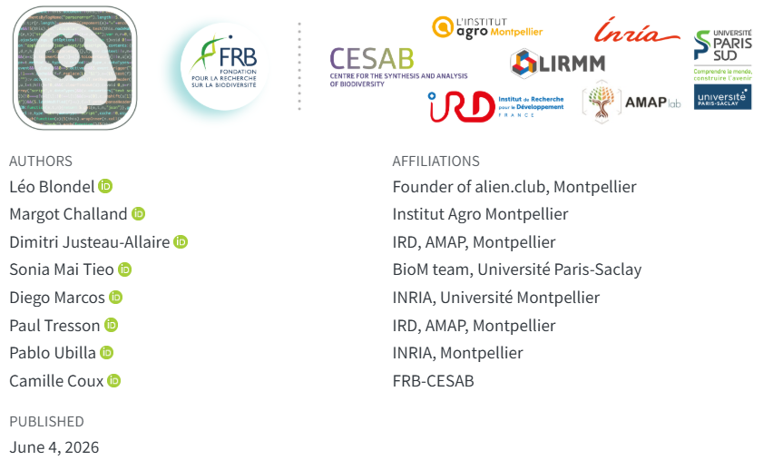
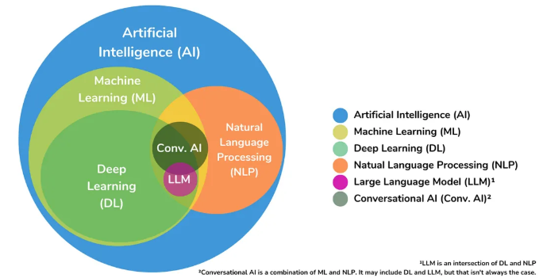
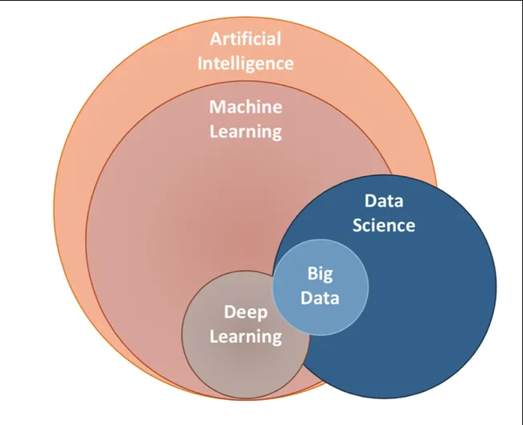
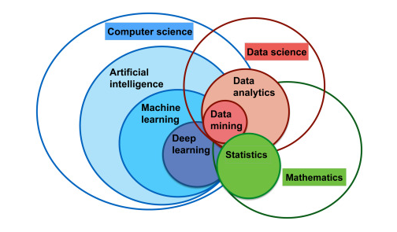

## Let's Start With a Quick Scan... {.smaller}

::: {.flex-row style="align-items: center; margin-top: 25px;"}

::: {.flex-col .flex-2}
<h3 style="font-size: 1.5em; line-height: 1.3; margin-bottom: 20px;">
What is the very first word (or words) that come to mind when someone mentions Artificial Intelligence?
</h3>

::: {.box-grey}
- Go to **slido.com** and enter code **`#[SLIDO_1_CODE]`** (or scan the QR code).
- Submit **as many words as you like** — we will capture this baseline map now and revisit it at the end of Part 1.
:::
:::

::: {.flex-col style="align-items: center;"}

**[QR CODE: Slido 1 — Word Cloud]**  
Save file as: <code>assets/images/slido_1_wordcloud_qr.png</code>  
<em>(Switch browser tab to Slido Present Mode for live word cloud)</em>
<!-- {width="100%"} -->

:::

:::

::: {.notes}
**OPENING ICEBREAKER (deliver while on Slide 1 before advancing here):**
"Good morning everyone. Before we dive in, let me lower the pressure—mostly for myself! I am not an AI researcher or a computer scientist; I am a PhD student in ecotoxicology. My goal today is not to lecture you as an expert, but to share a structured, critical compass from the FRB-CESAB training I attended thanks to FR BioEEnViS."

**ON SLIDE 2:**
Switch browser tab (Ctrl+Tab) to Slido Present Mode so the audience watches the word cloud build live.
**Narrative mission:** Expect words like ChatGPT, LLMs, Gemini, chatbots to dominate the center. Note it out loud—do not dismiss it, just say: "Keep this picture in mind. We will come back to it."
:::

## The BioEEnViS Opportunity {.smaller}

::: {.flex-row style="margin-top: 10px;"}

::: {.flex-col}
::: {.box-teal style="flex: 1; display: flex; flex-direction: column; justify-content: center;"}
**PhD Motivation: Bridging the Methodological Gap**

- Early in my thesis, we considered AI to **guide ecotoxicological experimental designs** or extract experimental data.
- This problem differs from standard ecotoxicology AI uses (e.g., **QSARs** or direct toxicity prediction).
- Because I lacked formal AI training, I applied for an **FR BioEEnViS Mobility Grant** to acquire structured external foundations.
:::
:::

::: {.flex-col style="flex: 0.12; align-items: center; justify-content: center;"}
<h2 style="margin: 0; color: #6c757d;">→</h2>
:::

::: {.flex-col}
::: {.box-grey style="flex: 1; display: flex; flex-direction: column;"}
**The External Training Resource**

- **FRB-CESAB (Montpellier, June 2026):** [*"AI for Ecologists: A Toolkit"*](https://ai-ecol.github.io/) — 5-day intensive course (all materials open-access).

**[IMAGE: FRB-CESAB Course Website / Logo + BioEEnViS Logo]** 
Save file as: <code>assets/images/cesab_website_screenshot.png</code>
<!-- {width="100%"} -->

:::
:::

:::

::: {.box-blue style="margin-top: 10px; padding: 10px 16px; font-size: 0.74em;"}
**Local Acknowledgment (independent of the BioEEnViS mobility grant):** Prior to Montpellier, attending [**AI4Biomed**](https://indico.engineering.univ-lyon1.fr/event/29/) in Lyon—mainly organized and promoted by **LBBE members**—introduced key terminology that made the CESAB transition much smoother.
:::

## The CESAB Experience {.smaller auto-animate="true"}
Four core modules covered during the 5-day [FRB-CESAB program](https://ai-ecol.github.io/):

 

:::: {.r-hstack style="gap: 18px; margin-top: 25px;"}
::: {data-id="card1" class="box-grey" style="width: 280px; height: 260px; display: flex; flex-direction: column; justify-content: center; text-align: center;"}
**Module 1**  
Introduction to AI, History & Machine Learning Foundations
:::

::: {data-id="card2" class="box-grey" style="width: 280px; height: 260px; display: flex; flex-direction: column; justify-content: center; text-align: center;"}
**Module 2**  
Introduction to Deep Learning & Neural Architectures
:::

::: {data-id="card3" class="box-grey" style="width: 280px; height: 260px; display: flex; flex-direction: column; justify-content: center; text-align: center;"}
**Module 3**  
Applied Deep Learning *(Species Distribution Models & LLMs)*
:::

::: {data-id="card4" class="box-grey" style="width: 280px; height: 260px; display: flex; flex-direction: column; justify-content: center; text-align: center;"}
**Module 4**  
Symbolic AI & Constraint-Based Reasoning
:::
::::

## The CESAB Experience {.smaller auto-animate="true"}
All four modules converge on a single pedagogical objective:

 

:::: {.r-stack style="margin-top: 30px;"}
::: {data-id="card1" class="box-grey" style="width: 780px; height: 250px; border-radius: 10px; opacity: 0.25;"}
:::

::: {data-id="card2" class="box-grey" style="width: 760px; height: 240px; border-radius: 10px; opacity: 0.25;"}
:::

::: {data-id="card3" class="box-grey" style="width: 740px; height: 230px; border-radius: 10px; opacity: 0.25;"}
:::

::: {data-id="card4" class="box-red" style="width: 740px; height: 220px; border-radius: 10px; display: flex; flex-direction: column; justify-content: center; text-align: center; padding: 24px;"}
Official Course Objective — ai-ecol.github.io
*"Give participants the **autonomy** to assess which algorithms are most adapted to their own research questions, where to find them, and how to adjust them to the desired question."*
:::
::::

## The CESAB Experience {.smaller auto-animate="true"}

::: {data-id="card4" class="box-red" style="padding: 10px 18px; margin-bottom: 16px; font-size: 0.76em; text-align: center;"}
**Course Objective:** Autonomy to assess which algorithms fit your research question ([ai-ecol.github.io](https://ai-ecol.github.io/)) $\rightarrow$ **Translated into 4 Core Insights (Today's Roadmap)**
:::

::: {.flex-row}
::: {.flex-col}
::: {data-id="card1" class="box-teal"}
**Insight 1 · AI > Generative Chatbots** 
*Covered next:* Distinguish GenAI from the wider AI taxonomy (ML, DL, Symbolic AI) and assess its epistemic & ecological costs.
:::

::: {data-id="card2" class="box-teal"}
**Insight 2 · Domain Baseline Primes** 
*Covered in Section 2:* Ecological and statistical knowledge anchors plausibility and dictates how a problem is framed.
:::
:::

::: {.flex-col}
::: {data-id="card3" class="box-teal"}
**Insight 3 · Exhaust Traditional Methods** 
*Covered in Section 2:* Verify dimensionality and exhaust classical statistical analyses before adopting complex ML.
:::

::: {data-id="card4b" class="box-teal"}
**Insight 4 · Explicit Trade-Offs** 
*Covered in Section 3:* Balance predictive gain against explainability based on the scientific goal.
:::
:::
:::

<em>Note: Part 1 is a curated synthesis of CESAB Day 1 principles—not a full 5-day syllabus dump. Part 2 (10:45) shows how these insights landed in my PhD.</em>

## Why Learn AI? A Bio-Inspired Paradox {.smaller}
As a scientist trained to look for mechanistic explanations, why invest in learning opaque algorithms?

::: {.flex-row style="margin-top: 10px;"}

::: {.flex-col}
::: {.box-grey style="flex: 1; display: flex; flex-direction: column;"}
**Biological Signal Integration (Human Learning)**

- Biological neurons integrate electrochemical inputs across complex networks.
- Scientific understanding emerges through **effortful cognitive friction**—writing, debugging, synthesizing, and testing hypotheses.

**[IMAGE: Biological Neuron / Synaptic Integration]** 
Save file as: <code>assets/images/bio_neuron.png</code>
<!-- {width="90%"} -->

:::
:::

::: {.flex-col}
::: {.box-teal style="flex: 1; display: flex; flex-direction: column;"}
**Artificial Neuron (Perceptron, 1957)**

- Loosely inspired by biology: `Inputs` $\rightarrow$ `Weights` $\rightarrow$ `Weighted Sum` $\rightarrow$ `Activation` $\rightarrow$ `Output`.
- Parameter estimation is **numerical loss minimization**—not biological reasoning or comprehension.

**[IMAGE: Perceptron Diagram (CESAB Day 1 Slide 70)]** 
Save file as: <code>assets/images/artificial_perceptron.png</code>
<!-- {width="90%"} -->

:::
:::

:::

::: {.fragment .box-red style="margin-top: 10px; text-align: center;"}
**The Paradox:** AI delivers major scientific breakthroughs (e.g., AlphaFold), yet our most frequent daily contact is with **Generative AI chatbots**. When misused to bypass writing, literature synthesis, or coding, a bio-inspired tool **short-circuits our own biological learning process**.
:::

## Epistemic & Ecological Guardrails (Insight 1a) {.smaller}

::: {.flex-row style="margin-top: 6px;"}

::: {.flex-col .flex-2}
::: {.incremental}
- **Cognitive Proletarianization:** Externalizing analytical tasks erodes our *savoir-faire* and methodological metacognition (Stiegler, 2010).
- **Empirical Evidence on Cognition:** Controlled studies indicate that over-reliance on GenAI can reduce knowledge retention (Barcaui, 2025), lower persistence and independent performance (Liu et al., 2026, *preprint*), and foster dependence/deskilling (Kim et al., 2025).
- **Illusions of Understanding:** Fluent outputs can mask weak epistemic grounding (Messeri & Crockett, 2024)—sparking active debate across French doctoral schools on protecting core research training.
- **Pragmatic Guardrail:** Retain cognitive friction for reasoning, writing, and analysis. Delegate routine formatting or syntax checks; shift from *"Do X"* to *"Critique / explain X"*.
:::
:::

::: {.flex-col .fragment}
::: {.box-grey style="flex: 1; display: flex; flex-direction: column; padding: 12px;"}
**Material & Ecological Footprint**

- Global energy-economy modeling shows AI productivity gains can drive net $\text{CO}_2$ increases via rebound effects (Alpine et al., 2026).
- Infrastructure expansion concentrates in water-stressed regions (e.g., **Uruguay: 1.77** and **Chile: 3.49** data centers per 1M inhabitants; [IFC, 2026](https://www.ifc.org/en/insights-reports/2026/risks-and-opportunities-in-data-center-and-ai-investment-in-ems#group-section-Fig-2-K8AjwpCMpV)).

**[IMAGE: IFC 2026 Data Centers Map — Uruguay 1.77]** 
Save file as: <code>assets/images/datacenters_uruguay_ifc2026.png</code>
<!-- {width="100%"} -->

"Only a tiny proportion of water in Uruguay is used for human consumption." — Daniel Pena ([Rest of World, 2026](https://restofworld.org/2026/ai-datacenters-water-resistance-global/))

:::
:::

:::

::: {.ref-footer}
Stiegler (2010) *For a New Critique of Political Economy* · Messeri & Crockett (2024) *Nature* [10.1038/s41586-024-07146-0](https://doi.org/10.1038/s41586-024-07146-0) · Barcaui (2025) *SSH Open* [10.1016/j.ssaho.2025.102287](https://doi.org/10.1016/j.ssaho.2025.102287) · Kim et al. (2025) *Consum. Psychol. Rev.* [10.1002/arcp.70008](https://doi.org/10.1002/arcp.70008) · Liu et al. (2026) [arXiv:2604.04721](https://arxiv.org/abs/2604.04721) · Alpine et al. (2026) *npj Clim. Action* [10.1038/s44168-026-00411-0](https://doi.org/10.1038/s44168-026-00411-0)
:::

# Section 1: AI is an Umbrella Term {background-color="#005a8c"}
Insight 1b — Moving beyond chatbots to map the algorithmic toolkit

## AI is Not a Monolith... It Is an Umbrella Term {.smaller}
**Quick Poll (Slido 2):** Which of these four diagrams correctly organizes Artificial Intelligence?

::: {.flex-row style="margin-top: 8px;"}

::: {.flex-col .flex-2}
::: {.flex-row style="margin-bottom: 10px;"}

**A. Nested Algorithms** 
<code>assets/images/taxo_1_nested_algorithms.png</code>
<!-- {height="195px"} -->

**B. AI / ML / DL / NLP / LLM** 
<code>assets/images/taxo_2_venn_nlp_llm.png</code>
<!-- {height="195px"} -->

:::

::: {.flex-row}

**C. AI / Data Science / Big Data** 
<code>assets/images/taxo_3_venn_bigdata.png</code>
<!-- {height="195px"} -->

**D. CS / AI / Data Science / Math** 
<code>assets/images/taxo_4_venn_cs_stats.png</code>
<!-- {height="195px"} -->

:::
:::

::: {.flex-col style="justify-content: space-between;"}

**[QR CODE: Slido 2 — Multiple Choice]** 
<code>assets/images/slido_2_taxonomy_qr.png</code> 
Code: <code>#[SLIDO_2_CODE]</code>
<!-- {width="85%"} -->

::: {.fragment .box-teal style="margin-top: 10px;"}
**Answer: All four are partial lenses.** 
There is no single formal definition of AI—each diagram highlights a different disciplinary cut (algorithms, language, data, or math).
:::
:::

:::

## Navigating the AI Vocabulary {.smaller auto-animate="true"}
In practice, researchers encounter a scattered soup of overlapping terms and tools:

 

::: {.bubble-cloud}
Linear & Logistic Regression
ChatGPT / Claude / Perplexity
Symbolic Logic & Rules
PCA / UMAP
CNN & RNN
Data Science & Statistics
Random Forest & Decision Trees
Intelligent Robots
Neural Networks (MLP)
Support Vector Machines (SVM)
Knowledge Representation
:::

Which field contains which—and where do everyday chatbots actually sit?

## Navigating the AI Vocabulary {.smaller auto-animate="true"}
Organizing the umbrella into parallel domains and nested subsets:

::: {.nest-ai style="margin-top: 6px;"}
ARTIFICIAL INTELLIGENCE (Umbrella Discipline)

::: {.flex-row style="gap: 14px;"}

::: {.flex-col}
::: {.box-grey style="height: 100%; margin-bottom: 0;"}
Symbolic AI, Reasoning & Embodied Systems

Symbolic Logic & Rules
Knowledge Representation
Intelligent Robots

Explicit rules, ontologies, and constraint solving (e.g., protected-area design in CESAB Day 5).

Overlapping Quantitative Pillar
Data Science & Statistics

:::
:::

::: {.flex-col .flex-2}
::: {.nest-ml}
MACHINE LEARNING (Automated Learning from Data)

Linear & Logistic Regression
PCA / UMAP
Support Vector Machines (SVM)
Random Forest & Decision Trees

::: {.nest-dl}
DEEP LEARNING (Multi-Layer Neural Networks)

Neural Networks (MLP)
CNN & RNN

::: {.nest-gen}
GENERATIVE AI & LLMs (A small, highly visible subset)
ChatGPT / Claude / Perplexity
:::
:::
:::
:::

:::
:::

**Standard reference taxonomy:** The [OECD Framework for the Classification of AI Systems](https://oecd.ai/en/classification) classifies systems by model type (*symbolic, statistical, or hybrid*), learning paradigm, and transparency.

::: {.notes}
Optional backup: You can keep `assets/images/oecd_ai_classification.png` in your backup folder or click the live OECD link during Q&A if anyone asks for formal regulatory criteria.
:::

# Section 2: From Classical Data to ML {background-color="#005a8c"}
Insights 2 & 3 — Domain baseline, dimensionality, and exhausting traditional methods

## When Does a Research Problem Need ML? {.smaller}
*Scenario:* An environmental scientist monitors **100 river sites** across chemical concentrations, water quality, climate, and community traits.

::: {.flex-row style="margin-top: 10px;"}

::: {.flex-col}
::: {.box-grey}
**What Is a "Dimension"?**

- **In Ecology / Env. Science:** Usually 3D physical space $(x, y, z)$ + time.
- **In Machine Learning:** **Every measured variable is an axis ($d$).** Measuring 50 water chemistry & species variables places each site in a 50-dimensional space.
:::

::: {.fragment .box-red}
**The Curse of High Dimensionality**

In a unit hypercube with $n=100$ samples, the edge length $l = (k/n)^{1/d}$ needed to capture even $k=1$ neighbor grows rapidly:

| Dimensions ($d$) | 2 | 3 | 10 | 100 |
| :--- | :---: | :---: | :---: | :---: |
| **Cube edge ($l$)** | 0.10 | 0.21 | 0.63 | **0.955** |

Distance flattens; almost every observation lies near the "border."
:::
:::

::: {.flex-col}

**[IMAGE: CESAB Day 1 — Hypercube Distance & 3D-to-2D Manifold]** 
Save file as: <code>assets/images/curse_dim_cube_manifold.png</code>
<!-- {width="100%"} -->

::: {.fragment .box-teal style="margin-top: 12px;"}
**The Methodological Filter**

- **Low $d$, linear/known structure?** Traditional statistics are sufficient and preferable.
- **High $d$, sparse space?** Dimensionality reduction (PCA, UMAP) and ML help uncover lower **intrinsic dimensionality** (manifolds).
:::
:::

:::

## Demystifying ML: Scaling One Research Question {.smaller}
Following the same environmental dataset from classical statistics into the ML toolkit:

::: {.flex-row style="margin-top: 8px;"}
::: {.flex-col}
::: {.box-grey style="height: 100%;"}
**1. Classical Baseline** 
One predictor, linear trend: 
$Y = ax + b + \varepsilon$

Solved analytically via Ordinary Least Squares.
:::
:::

::: {.flex-col style="flex: 0.08; align-items: center; justify-content: center;"}
<h3 style="margin: 0; color: #6c757d;">→</h3>
:::

::: {.flex-col}
::: {.fragment .box-teal style="height: 100%;"}
**2. Same Problem as ML** 
Any ML workflow = **3 parts**:

1. **Model** (equation)
2. **Loss function** (error metric, e.g., MSE)
3. **Solver** (iterative step, e.g., gradient descent)
:::
:::

::: {.flex-col style="flex: 0.08; align-items: center; justify-content: center;"}
<h3 style="margin: 0; color: #6c757d;">→</h3>
:::

::: {.flex-col}
::: {.fragment .box-blue style="height: 100%;"}
**3. Earned Complexity** 
Add non-linear thresholds, categories, or high-$d$ features:

Move deliberately along the toolkit $\rightarrow$ **Classification (Cross-Entropy), Random Forests, SVMs, or Neural Nets**.
:::
:::
:::

::: {.flex-row style="margin-top: 10px; align-items: center;"}
::: {.flex-col .flex-2}
<table style="width: 100%; font-size: 0.7em; border-collapse: collapse; background: #ffffff; border-radius: 6px; overflow: hidden;">
  <tr style="background: #005a8c; color: #ffffff;">
    <th style="padding: 6px 10px; text-align: left;">Classical Statistics Dictionary</th>
    <th style="padding: 6px 10px; text-align: left;">Machine Learning Dictionary</th>
    <th style="padding: 6px 10px; text-align: left;">Scientific Note</th>
  </tr>
  <tr style="border-bottom: 1px solid #dee2e6;">
    <td style="padding: 6px 10px;">Covariates / Explanatory variables ($X$)</td>
    <td style="padding: 6px 10px; color: #005a8c; font-weight: 600;">Features / Inputs</td>
    <td style="padding: 6px 10px;">Domain knowledge guides selection</td>
  </tr>
  <tr style="border-bottom: 1px solid #dee2e6;">
    <td style="padding: 6px 10px;">Response variable ($Y$) & Residuals</td>
    <td style="padding: 6px 10px; color: #005a8c; font-weight: 600;">Target / Label & Loss Function</td>
    <td style="padding: 6px 10px;">Defines what is optimized</td>
  </tr>
  <tr>
    <td style="padding: 6px 10px;">Mechanistic / Biological parameters</td>
    <td style="padding: 6px 10px; color: #005a8c; font-weight: 600;">Weights / Hyperparameters</td>
    <td style="padding: 6px 10px;"><strong>Often have no biological meaning</strong></td>
  </tr>
</table>
:::

::: {.flex-col .fragment}
::: {.box-red style="margin-bottom: 0; font-size: 0.76em;"}
**Check before scaling up:** 
Exhaust classical exploratory data analysis first. Complex algorithms are justified only when data shape and dimensionality demand them.
:::
:::
:::

## Interactive Checkpoint: Frame Your Question {.smaller}

::: {.flex-row style="align-items: center; margin-top: 20px;"}

::: {.flex-col .flex-2}
<h3 style="font-size: 1.35em; line-height: 1.3; margin-bottom: 18px;">
How would you formulate one question from your own research as $Y \sim X$?
</h3>

::: {.box-teal}
In **Slido 3** (`#[SLIDO_3_CODE]`), write a short 1-line formulation:

1. **Target ($Y$):** What do you want to explain or predict? *(continuous value or category?)*
2. **Features ($X$):** What predictors do you have—and roughly how many dimensions ($d$)?
3. **Priority:** Do you care more about **mechanistic inference** or **predictive accuracy**?
:::
:::

::: {.flex-col style="align-items: center;"}

**[QR CODE: Slido 3 — Open Text ($Y \sim X$)]**  
Save file as: <code>assets/images/slido_3_research_qr.png</code>  
<em>(Switch browser tab to Slido Present Mode to discuss live examples)</em>
<!-- {width="100%"} -->

:::

:::

# Section 3: The Modelling Trade-Off {background-color="#005a8c"}
Insight 4 — Balancing predictive performance and explainability

## The Two Cultures & The Flexible Trade-Off {.smaller}

::: {.flex-row style="margin-top: 8px;"}

::: {.flex-col}
::: {.box-grey style="height: 100%;"}
**Data Modeling Culture** *(Classical Statistics)*

- Assumes data arise from a specified stochastic/mechanistic process (e.g., GLMMs, ODEs).
- **Primary goal:** Parameter inference, uncertainty quantification, and causal interpretation.
:::
:::

::: {.flex-col style="flex: 0.1; align-items: center; justify-content: center;"}
<h3 style="margin: 0; color: #6c757d;">↔</h3>
:::

::: {.flex-col}
::: {.box-teal style="height: 100%;"}
**Algorithmic Modeling Culture** *(Machine Learning)*

- Treats the underlying data-generating mechanism as unknown or too complex to write analytically.
- **Primary goal:** Out-of-sample predictive accuracy across high-dimensional, non-linear interactions.
:::
:::

:::

::: {.spectrum-bar}
High Interpretability <small>Linear / Mechanistic (GUTS)</small>
← Hybrid & Explainable AI (XAI) → <small>Decision Trees · Random Forests + Feature Importance</small>
High Predictive Capacity <small>Deep Neural Networks</small>
:::

::: {.fragment .box-blue style="margin-top: 10px;"}
**A Pragmatic, Objective-Driven Choice:** Interpretability is not a dogma—it is an explicit scientific decision. High-throughput screening (e.g., QSARs) may justify prioritizing accuracy; regulatory or mechanistic risk assessment demands explainability. Increasingly, **hybrid pipelines** combine both.
:::

::: {.ref-footer}
Breiman, L. (2001). Statistical modeling: The two cultures. *Statistical Science*, 16(3), 199–231. [10.1214/ss/1009213726](https://doi.org/10.1214/ss/1009213726) · Rudin, C. (2019). Stop explaining black box machine learning models for high stakes decisions and use interpretable models instead. *Nature Machine Intelligence*, 1, 206–215. [10.1038/s42256-019-0048-x](https://doi.org/10.1038/s42256-019-0048-x)
:::

## Closing the Loop & Bridge to Part 2 {.smaller}

::: {.flex-row style="margin-top: 12px;"}

::: {.flex-col}
::: {.box-grey style="height: 100%; display: flex; flex-direction: column;"}
**Revisit Slide 2: Our Opening Word Cloud**

- Where did our collective word cloud cluster 45 minutes ago?
- AI is not synonymous with chatbots—it is an organized **toolkit** spanning symbolic logic, classical ML, deep learning, and generative models.

**[LIVE CALLBACK: Switch to Slido 1 Word Cloud tab]** 
*(Post-event: final exported word cloud will be archived on the workshop website)*

:::
:::

::: {.flex-col .fragment}
::: {.box-teal style="height: 100%; display: flex; flex-direction: column; justify-content: center;"}
**How These 4 Insights Reshaped My PhD**
*(Preview of Part 2 — Today at 10:45)*

1. **Exhausted traditional statistics first** (descriptive & linear multivariate audits) before invoking ML.
2. **Kept mechanistic models (GUTS)** at the core where biological interpretability is essential.
3. **Deployed ML as an explainable meta-model** to audit which experimental design features govern parameter precision.
:::
:::

:::

## Take-Home Messages {.smaller}

::: {.flex-row style="margin-top: 15px;"}

::: {.flex-col .flex-2 style="justify-content: center; padding-right: 16px;"}
<ol style="font-size: 1.05em; line-height: 1.65;">
  <li class="fragment"><b>AI is an Umbrella Toolkit:</b> Know the taxonomy before choosing an algorithm—GenAI chatbots are only one narrow subset.</li>
  <li class="fragment"><b>Protect Cognitive Friction:</b> Preserve your scientific <i>savoir-faire</i> and remain aware of the ecological footprint of GenAI workflows.</li>
  <li class="fragment"><b>Earn Model Complexity:</b> Check true dimensionality and exhaust classical statistical analyses before adopting ML.</li>
  <li class="fragment"><b>Align the Trade-Off to Your Goal:</b> Use domain knowledge to decide where interpretability is essential, where predictive power wins, or where hybrid approaches bridge both.</li>
</ol>

::: {.fragment .box-blue style="margin-top: 12px; font-size: 0.78em;"}
**Next up today (after a 15-min break):** **10:45 – 11:45 | Part 2 — Technical Case Study** (Applied ML & GUTS experimental designs).
:::
:::

::: {.flex-col style="border-left: 2px dashed #ced4da; padding-left: 24px; justify-content: center; gap: 14px;"}

**[QR CODE: FRB-CESAB Course]** 
<a href="https://ai-ecol.github.io/">ai-ecol.github.io</a> 
<code>assets/images/qr_cesab_course.png</code>
<!-- {width="140px"} -->

**[QR CODE: Workshop Site & Contact]** 
<code>assets/images/qr_workshop_contact.png</code>
<!-- {width="140px"} -->

:::

:::

## {background-color="#005a8c"}

  

Thank you — Questions?

Anthony Fow Esteves · anthony.fow@univ-lyon1.fr

  

:::: {.columns}
::: {.column width="30%"}

<code>assets/images/LBBE_LOGO_color.png</code>
<!-- {height="75px"} -->

:::

::: {.column width="5%"}
:::

::: {.column width="30%"}

<code>assets/images/INRAE_LOGO_color.png</code>
<!-- {height="75px"} -->

:::

::: {.column width="5%"}
:::

::: {.column width="30%"}

<code>assets/images/BIOEENVIS_LOGO.png</code>
<!-- {height="75px"} -->

:::
::::

::: {.footer}
Built with <a href="https://quarto.org" style="color: #00a3a6;">Quarto</a> · Supported by FR BioEEnViS
:::