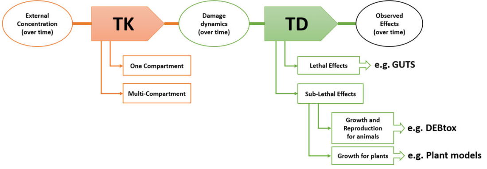
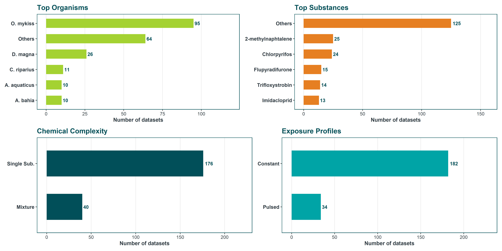
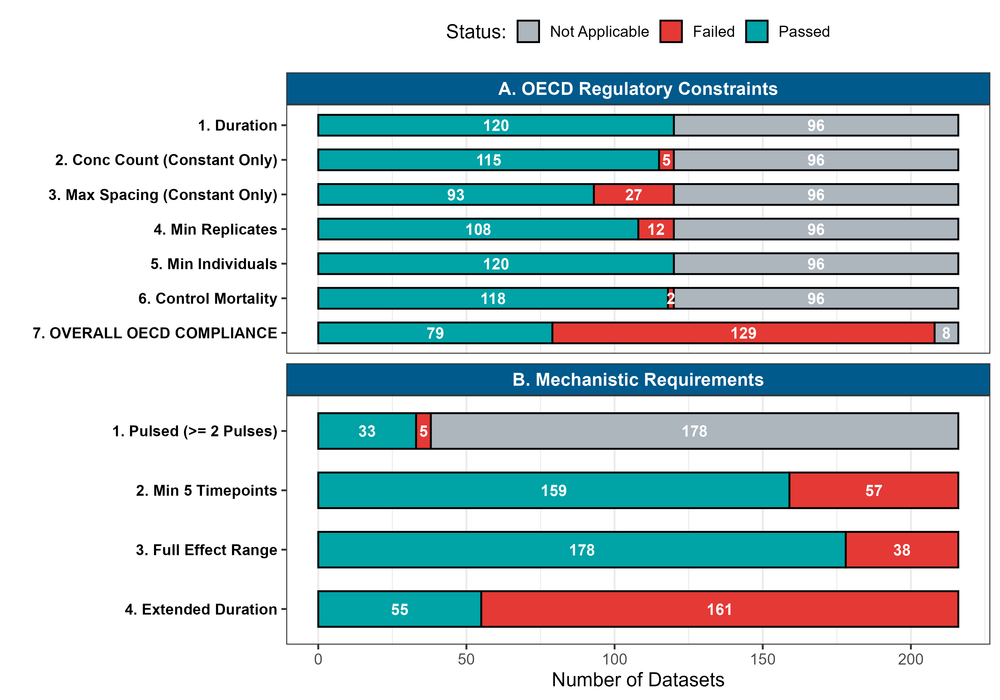
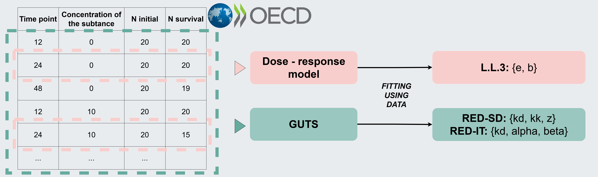
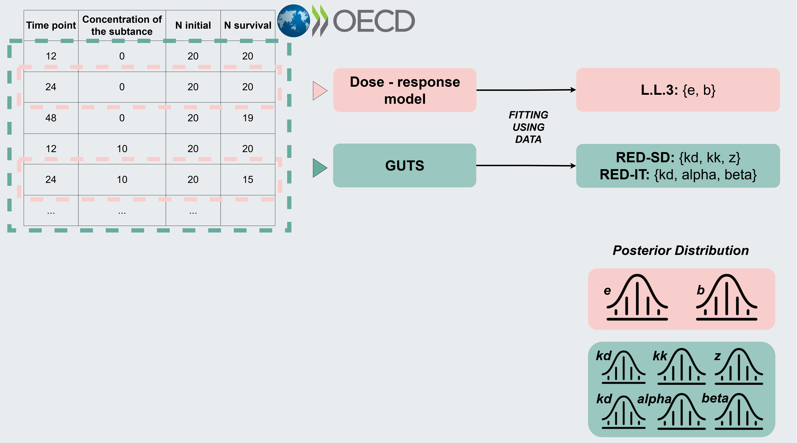
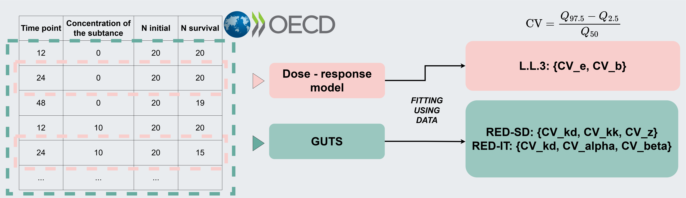
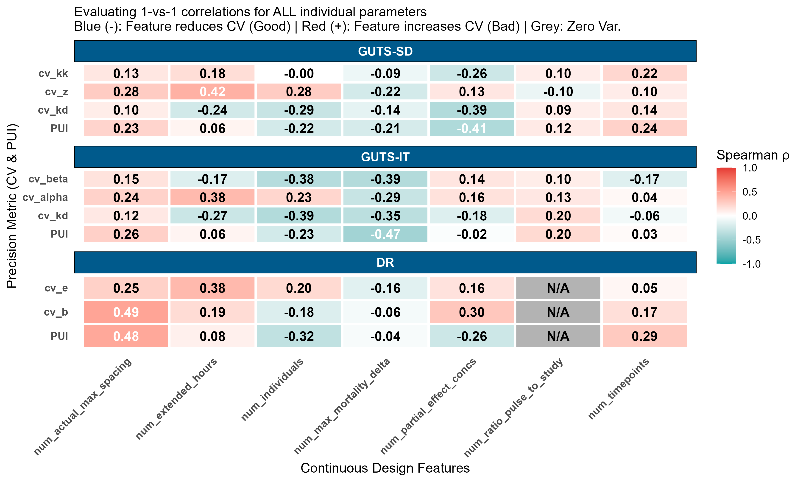
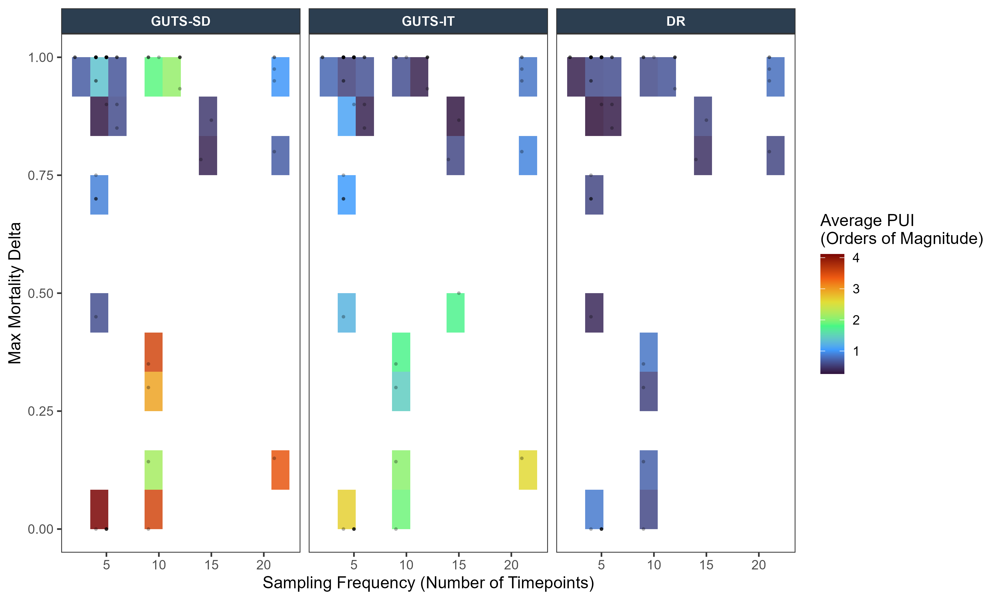

## {background-color="#005a8c"}

::: {.title-slide-wrap}
<h1>Beyond Standardised Guidelines</h1>

Towards an Explainable Machine Learning for Model-Guided Ecotoxicological Study Designs

Restitution of the FRB-CESAB 'AI for Ecologists: A Toolkit' Training — FR BioEEnViS

<strong>Anthony Fow Esteves</strong>

LBBE – UCB Lyon 1 (UMR CNRS 5558) | Ecotox – UR RiverLy (INRAE)

December 16, 2026

:::

## Why ML in My Project? {.smaller}

Positioning this case study along Part 1's modelling spectrum: coupling a mechanistic core with an interpretable audit.

::: {.flex-row style="gap: 10px; align-items: stretch; margin-top: 14px; margin-bottom: 22px; min-height: 195px;"}

::: {.spec-box style="background: #eef4f8; border: 2px solid #005a8c; border-top: 6px solid #005a8c;"}
[White Box]{.card-title style="font-size: 1.15em; color: #005a8c;"}

**Mechanistic Core: GUTS & DR**

Explicit toxicokinetic–toxicodynamic equations calibrated on survival data.
:::

::: {.spec-arrow}
→
:::

::: {.spec-box .box-teal style="margin-bottom: 0; border: 2.5px solid #00a3a6; border-left: 6px solid #00a3a6; box-shadow: 0 6px 14px rgba(0,163,166,0.12);"}
[Grey Box]{.card-title style="font-size: 1.15em; color: #018b8d;"}

**Towards Explainable ML Audit — Current Focus**

Auditing how experimental design features govern mechanistic parameter uncertainty.
:::

::: {.spec-arrow style="opacity: 0.45;"}
→
:::

::: {.spec-box style="background: #f1f3f5; border: 2px dashed #adb5bd; opacity: 0.45;"}
[Black Box]{.card-title style="font-size: 1.15em; color: #495057;"}

**Deep Learning / Neural Networks**

Deliberately excluded in this sample regime and regulatory context.
:::

:::

::: {.fragment}
::: {.flex-row style="gap: 16px;"}

::: {.flex-col .box-grey style="margin-bottom: 0;"}
[1. Tabular Data Regime ($n = 216$)]{.card-title style="font-size: 0.98em; color: #005a8c; margin-bottom: 5px;"}

Tree ensembles limit overfitting compared to deep architectures.
:::

::: {.flex-col .box-grey style="margin-bottom: 0;"}
[2. Regulatory Traceability (EFSA / OECD)]{.card-title style="font-size: 0.98em; color: #005a8c; margin-bottom: 5px;"}

Auditable links between experimental inputs and parameter uncertainty.
:::

::: {.flex-col .box-grey style="margin-bottom: 0;"}
[3. Protocol Design Objective]{.card-title style="font-size: 0.98em; color: #005a8c; margin-bottom: 5px;"}

Guiding laboratory study designs, not black-box prediction.
:::

:::
:::

::: {.notes}
Frame this slide directly as a continuation of Part 1's spectrum. Remind the audience that Random Forest is already an interpretable ML method used here strictly as an exploratory audit—not yet a final predictive optimizer. Keep the rationale against Deep Learning grounded on objective scientific criteria (moderate tabular n = 216 + regulatory traceability under EFSA/OECD), and explicitly invite the bioinformatics/AI team to challenge this modelling choice during the closing discussion.
:::

## From Everyday Products to Freshwater Exposure {.smaller}

Regulatory context for non-ecotoxicologists: tracing everyday agricultural products to freshwater screening.

::: {.flex-row style="gap: 12px; align-items: stretch; margin-bottom: 14px;"}

::: {.step-card}
[1. Everyday Products]{.card-title style="font-size: 1.02em; color: #005a8c;"}

🍎 &nbsp; 🍷 &nbsp; 🥖

Apple, red wine, and baguette represent routine food chains sustained by intensive crop production.
:::

::: {.spec-arrow .fragment}
→
:::

::: {.step-card .fragment style="border-top-color: #00a3a6;"}
[2. Large-Scale Agriculture]{.card-title style="font-size: 1.02em; color: #018b8d;"}

🌾 &nbsp; 🚜

Relies on **Plant Protection Products (PPPs)** to protect yields against fungi, insects, and weeds.
:::

::: {.spec-arrow .fragment}
→
:::

::: {.step-card .fragment style="border-top-color: #e53935;"}
[3. Freshwater Runoff]{.card-title style="font-size: 1.02em; color: #e53935;"}

🌧️ &nbsp; 🏞️ &nbsp; 🐟

Runoff exposes non-target aquatic organisms, triggering mandatory pre-market regulatory screening.
:::

:::

::: {.plot-placeholder style="min-height: 195px; padding: 12px;"}

assets/images/ws2/ws2_hook_ppp_products.png

<strong>Visual Hook Strip</strong> — Everyday products (Apple, Red Wine, Baguette) → large-scale PPP agriculture → freshwater runoff into aquatic ecosystems.

:::

::: {.notes}
Keep this fast and concrete for the bioinformatics/AI colleagues: every PPP entering European agriculture must pass pre-market freshwater risk screening before authorisation.
:::

## EU Environmental Risk Assessment (ERA) Pipeline {.smaller}

Where experimental ecotoxicology and mechanistic modelling enter European chemical regulation.

::: {.flex-row style="gap: 10px; align-items: stretch; margin-bottom: 12px;"}

::: {.era-node style="flex: 0.85; border-top: 4px solid #005a8c;"}
**Problem Formulation**

Define substance, use scenario, and protection goals.
:::

::: {.arch-flow-arrow}
→
:::

::: {.flex-col style="flex: 1.45; gap: 8px;"}
::: {.era-node style="opacity: 0.48; background: #f1f3f5;"}
**Exposure Assessment** *(Environmental Fate)*

Predicted environmental concentrations ($PEC$) in water.
:::

::: {.era-node .fragment style="background: #e6f6f6; border: 2px solid #00a3a6; border-left: 6px solid #00a3a6;"}
**Effect Assessment — Laboratory Ecotoxicity Experiments**

Empirical survival bioassays estimating organism sensitivity ($LC_{50}$, $EC_x$, TKTD).
:::
:::

::: {.arch-flow-arrow .fragment}
→
:::

::: {.era-node .fragment style="flex: 0.85; border-top: 4px solid #005a8c;"}
**Risk Characterisation**

Compare exposure against effect thresholds.
:::

::: {.arch-flow-arrow .fragment}
→
:::

::: {.era-node .fragment style="flex: 0.9; border-top: 4px solid #018b8d;"}
**EU Approval Decision**

Authorisation or renewal (e.g., *Captan* renewed until 2039).
:::

:::

::: {.plot-placeholder style="min-height: 190px; padding: 10px; margin-bottom: 12px;"}

assets/images/ws2/ws2_era_flowchart.png

<strong>EU ERA Regulatory Flowchart</strong> — Highlighting Effect Assessment and empirical aquatic toxicity testing leading to EU regulatory approval.

:::

::: {.box-teal style="margin-bottom: 0; text-align: center;"}
Our modelling work operates directly inside **Effect Assessment**—and up to here, we have only talked about PPPs.
:::

::: {.notes}
Emphasise that Effect Assessment depends directly on laboratory ecotoxicity experiments. Close the slide with the pivot line: "Up to here, we have only talked about PPPs"—setting up the chemical scale bottleneck on the next slide.
:::

## The Scale & Ethical Bottleneck {.smaller}

Beyond PPPs: why testing every chemical experimentally is neither scalable nor ethically defensible.

::: {.flex-row style="min-height: 445px; align-items: stretch;"}

::: {.flex-col}
::: {.box-red style="flex: 1; display: flex; flex-direction: column; justify-content: center; margin-bottom: 0;"}
[Global Chemical Inventory vs. Testing Burden]{.card-title style="font-size: 1.06em; color: #e53935; margin-bottom: 10px;"}

- **$>350,000$** registered chemicals globally.
- **$19,670$** substances mapped across EU legal frameworks.
- **$1,474$** PPPs listed in the EU pesticide database.
- **$440,000$–$2.2\text{ million}$** fish and birds used annually in ecotoxicity testing ($>\$39\text{M/yr}$; Schür et al., 2025).

::: {style="margin-top: 12px; padding-top: 10px; border-top: 1px solid #f1c0c0;"}
This creates an urgent ethical (3Rs) and economic imperative for **Predictive Ecotoxicology**.
:::
:::
:::

::: {.flex-col}
::: {.plot-placeholder}

assets/images/ws2/ws2_chemicals_scale.png

<strong>Chemical Scale &amp; Animal Testing Burden</strong> Comparing global chemical inventories against annual vertebrate usage in regulatory testing.

:::
:::

:::

::: {.notes}
This slide provides the ethical and practical motivation: brute-force experimental testing cannot cover the chemical universe, so predictive mechanistic models must extract maximum reliable information from every animal test performed.
:::

## EFSA Shift vs. The Historical Regulatory Mismatch {.smaller}

::: {.flex-row style="gap: 18px; margin-bottom: 12px;"}

::: {.flex-col}
::: {.box-teal style="flex: 1; display: flex; flex-direction: column; margin-bottom: 0;"}
[1. 2018+ EFSA Shift]{.card-title style="font-size: 1.02em; color: #018b8d; margin-bottom: 6px;"}

EFSA recommends dynamic **TKTD** mechanistic models—specifically **GUTS** (General Unified Threshold model of Survival)—for regulatory PPP risk assessment ([EFSA, 2018](https://onlinelibrary.wiley.com/doi/abs/10.2903/j.efsa.2018.5377)).

{style="max-height: 115px; width: 100%; object-fit: contain; margin-top: 8px;"}
:::
:::

::: {.flex-col .fragment}
::: {.box-red style="flex: 1; display: flex; flex-direction: column; margin-bottom: 0;"}
[2. The Legacy Mismatch]{.card-title style="font-size: 1.02em; color: #e53935; margin-bottom: 6px;"}

Regulatory testing still depends on ~1980s **OECD Test Guidelines** built for static, fixed-time endpoints like $LC(50, 96\text{h})$ via Dose-Response (DR) models ([Daniels et al., 2026](https://doi.org/10.1093/inteam/vjaf113)).

{style="max-height: 115px; width: 100%; object-fit: contain; margin-top: 8px;"}
:::
:::

:::

::: {.fragment}
::: {.box-grey style="margin-bottom: 0; padding: 10px 14px; display: flex; align-items: center; gap: 16px;"}

assets/images/ws2/ws2_oecd_guts_preprint.png

<strong>Aside (Preprint):</strong> GUTS can be calibrated on standard OECD datasets, yet the limitations and impact on dynamic parameter inference remain unquantified.

:::
:::

::: {.notes}
Walk through the three clicks deliberately: (1) EFSA recommends dynamic GUTS models; (2) yet laboratory data still come from ~1980s OECD guidelines designed for static 96h Dose-Response endpoints; (3) calibrating GUTS on legacy OECD data is technically feasible, but its impact on parameter identifiability and precision remains unquantified. Cue the direct visual bridge into Slide 5 (model_process.png): we need reproducible, explainable guidance for both laboratory technicians and regulators.
:::

## Our Objective {.smaller}

::: {.center-content style="justify-content: space-evenly; padding-top: 8px;"}

{style="max-height: 315px; width: 96%; object-fit: contain;"}

::: {style="text-align: center; font-family: 'Space Grotesk', 'Segoe UI', system-ui, sans-serif; font-size: 1.88em; font-weight: 700; color: #005a8c; line-height: 1.38; max-width: 94%; margin-top: 8px;"}
How do experimental design features ($\mathcal{E}$) influence DR and GUTS parameter precision?
:::

:::

::: {.notes}
Point directly to the two ends of model_process.png without color confusion: on the left sits the experimental design structure E behind the survival table; on the right sit the calibrated parameter sets for DR and GUTS. Our question quantifies how choices on the left propagate into precision on the right.
:::

## The Empirical Landscape & Dataset Conceptualisation {.smaller}

Mapping <strong>216 time-resolved survival datasets</strong> across organisms, substances, and exposure profiles.

::: {.flex-row}

::: {.flex-col .flex-2}
{style="max-height: 495px; width: 100%; object-fit: contain;"}
:::

::: {.flex-col}
::: {.box-grey}
[Dataset Conceptualisation]{.card-title style="font-size: 1.02em; color: #005a8c; margin-bottom: 6px;"}

$$\mathcal{D} = \{\mathcal{E}, \mathbf{N}\}$$

*(Adapted from Baudrot & Charles, 2018)*

- **$\mathbf{N}$ (Survival observations):** enters the mechanistic model (**GUTS** / **DR**) to estimate parameters $\theta$.
:::

::: {.box-teal style="margin-bottom: 0;"}
[Role of $\mathcal{E}$ (Experimental Design Context)]{.card-title style="font-size: 1.02em; color: #018b8d; margin-bottom: 6px;"}

Accompanies $\mathbf{N}$ and $\theta$ throughout the workflow.

This is what we categorise against:

- **OECD TG Constraints**
- **Mechanistic Model Requirements**
:::
:::

:::

::: {.notes}
Introduce the compact notation D = {E, N} adapted from Baudrot & Charles (2018). From here onward, the tracking pill below each slide title will show which component—E, N, or their mapping—we are operating on.
:::

## Experimental Design Features (All 216 Datasets) {.smaller}

::: {.track-pill}
Tracking $\mathcal{D} = \{\mathcal{E}, \mathbf{N}\}$ · Categorising $\mathcal{E}$ (OECD & Mechanistic rules)
:::

::: {.flex-row}

::: {.flex-col}
Characterising the **experimental design features ($\mathcal{E}$)** across all 216 time-resolved survival datasets.

::: {.box-grey style="margin-top: 12px;"}
**OECD TG Constraints** 
Minimum experimental criteria specified by each OECD Test Guideline corresponding to our database characteristics.
:::

::: {.box-grey style="margin-top: 8px;"}
**Mechanistic Model Requirements** 
Specific experimental design features required to ensure **identifiability** and parameter precision according to [EFSA (2018)](https://onlinelibrary.wiley.com/doi/abs/10.2903/j.efsa.2018.5377) and [Jager & Ashauer (2025)](https://leanpub.com/guts_book).
:::
:::

::: {.flex-col .flex-2 .fragment}
{style="max-height: 475px; width: 100%; object-fit: contain;"}
:::

:::

## Analytical Subset: Trout & Daphnia {.smaller}

::: {.track-pill}
Tracking $\mathcal{D} = \{\mathcal{E}, \mathbf{N}\}$ · Categorising $\mathcal{E}$ (OECD & Mechanistic rules)
:::

::: {.flex-row}

::: {.flex-col}
Isolating a focused analytical subset: **Trout (*O. mykiss*)** and **Daphnia (*D. magna*)**.

::: {.box-grey style="margin-top: 12px;"}
**Why this subset?**

- Represents **~50%** of the full 216-dataset database.
- Preserves the categorical design proportions observed across all 216 datasets.
:::

::: {.fragment .box-teal style="margin-top: 8px;"}
**Next Methodological Step**

- Define a formal **precision metric** to address our objective:
  *How do **experimental design features ($\mathcal{E}$)** influence **DR and GUTS parameter precision**?*
:::
:::

::: {.flex-col .flex-2}
{style="max-height: 475px; width: 100%; object-fit: contain;"}
:::

:::

## The Data Analysis $\rightarrow$ ML Bridge {.smaller}

::: {.track-pill}
Tracking $\mathcal{D} = \{\mathcal{E}, \mathbf{N}\}$ · Fitting $\mathbf{N} \rightarrow \theta$ & summarising precision $Y(\theta)$ across $\mathcal{E}$
:::

In regulatory ecotoxicology, black-box AI faces justified skepticism. Every step toward ML must be documented.

::: {.flex-row}

::: {.flex-col .fragment style="flex: 0.34;"}
::: {.box-teal style="margin-bottom: 0;"}
[1. Descriptive]{.card-title style="font-size: 1.06em; color: #005a8c; margin-bottom: 8px;"}

Compute the **precision metrics** and visualise them by experimental design feature.
:::
:::

::: {.flex-col .fragment style="flex: 0.66;"}
{style="max-height: 455px; width: 100%; object-fit: contain;"}
:::

:::

## The Data Analysis $\rightarrow$ ML Bridge {.smaller}

::: {.track-pill}
Tracking $\mathcal{D} = \{\mathcal{E}, \mathbf{N}\}$ · Fitting $\mathbf{N} \rightarrow \theta$ & summarising precision $Y(\theta)$ across $\mathcal{E}$
:::

In regulatory ecotoxicology, black-box AI faces justified skepticism. Every step toward ML must be documented.

::: {.flex-row}

::: {.flex-col style="flex: 0.34;"}
::: {.box-teal style="margin-bottom: 0;"}
[1. Descriptive]{.card-title style="font-size: 1.06em; color: #005a8c; margin-bottom: 8px;"}

Compute the **precision metrics** and visualise them by experimental design feature.
:::
:::

::: {.flex-col style="flex: 0.66;"}
{style="max-height: 455px; width: 100%; object-fit: contain;"}
:::

:::

## The Data Analysis $\rightarrow$ ML Bridge {.smaller}

::: {.track-pill}
Tracking $\mathcal{D} = \{\mathcal{E}, \mathbf{N}\}$ · Fitting $\mathbf{N} \rightarrow \theta$ & summarising precision $Y(\theta)$ across $\mathcal{E}$
:::

In regulatory ecotoxicology, black-box AI faces justified skepticism. Every step toward ML must be documented.

::: {.flex-row}

::: {.flex-col style="flex: 0.34;"}
::: {.box-teal style="margin-bottom: 0;"}
[1. Descriptive]{.card-title style="font-size: 1.06em; color: #005a8c; margin-bottom: 8px;"}

Compute the **precision metrics** and visualise them by experimental design feature.
:::
:::

::: {.flex-col style="flex: 0.66;"}
{style="max-height: 455px; width: 100%; object-fit: contain;"}
:::

:::

## The Data Analysis $\rightarrow$ ML Bridge {.smaller}

::: {.track-pill}
Tracking $\mathcal{D} = \{\mathcal{E}, \mathbf{N}\}$ · Fitting $\mathbf{N} \rightarrow \theta$ & summarising precision $Y(\theta)$ across $\mathcal{E}$
:::

In regulatory ecotoxicology, black-box AI faces justified skepticism. Every step toward ML must be documented.

::: {.flex-row}

::: {.flex-col style="flex: 0.34;"}
::: {.box-teal style="margin-bottom: 0;"}
[1. Descriptive]{.card-title style="font-size: 1.06em; color: #005a8c; margin-bottom: 8px;"}

Compute the **precision metrics** and visualise them by experimental design feature.

[1.1 Precision Metrics]{.card-title style="font-size: 1.02em; color: #005a8c; margin-top: 12px; margin-bottom: 6px;"}

- **Coefficient of Variation (CV):** Individual parameter uncertainty.
- **Parameter Uncertainty Index (PUI)** ([Bauer et al., 2024](https://academic.oup.com/etc/article/43/1/197/7728569)): Global precision metric.
:::
:::

::: {.flex-col style="flex: 0.66;"}
{style="max-height: 455px; width: 100%; object-fit: contain;"}
:::

:::

## The Data Analysis $\rightarrow$ ML Bridge {.smaller}

::: {.track-pill}
Tracking $\mathcal{D} = \{\mathcal{E}, \mathbf{N}\}$ · Fitting $\mathbf{N} \rightarrow \theta$ & summarising precision $Y(\theta)$ across $\mathcal{E}$
:::

In regulatory ecotoxicology, black-box AI faces justified skepticism. Every step toward ML must be documented.

::: {.flex-row}

::: {.flex-col style="flex: 0.34;"}
::: {.box-teal style="margin-bottom: 0;"}
[1. Descriptive]{.card-title style="font-size: 1.06em; color: #005a8c; margin-bottom: 8px;"}

Compute the **precision metrics** and visualise them by experimental design feature.

[1.1 Precision Metrics]{.card-title style="font-size: 1.02em; color: #005a8c; margin-top: 12px; margin-bottom: 6px;"}

- **Coefficient of Variation (CV):** Individual parameter uncertainty.
- **Parameter Uncertainty Index (PUI)** ([Bauer et al., 2024](https://academic.oup.com/etc/article/43/1/197/7728569)): Global precision metric.
:::
:::

::: {.flex-col style="flex: 0.66;"}
{style="max-height: 455px; width: 100%; object-fit: contain;"}
:::

:::

## The Data Analysis $\rightarrow$ ML Bridge {.smaller}

::: {.track-pill}
Tracking $\mathcal{D} = \{\mathcal{E}, \mathbf{N}\}$ · Fitting $\mathbf{N} \rightarrow \theta$ & summarising precision $Y(\theta)$ across $\mathcal{E}$
:::

In regulatory ecotoxicology, black-box AI faces justified skepticism. Every step toward ML must be documented.

::: {.flex-row}

::: {.flex-col style="flex: 0.34;"}
::: {.box-teal style="margin-bottom: 0;"}
[1. Descriptive]{.card-title style="font-size: 1.06em; color: #005a8c; margin-bottom: 8px;"}

Compute the **precision metrics** and visualise them by experimental design feature.

[1.1 Precision Metrics]{.card-title style="font-size: 1.02em; color: #005a8c; margin-top: 12px; margin-bottom: 6px;"}

- **Coefficient of Variation (CV):** Individual parameter uncertainty.
- **Parameter Uncertainty Index (PUI)** ([Bauer et al., 2024](https://academic.oup.com/etc/article/43/1/197/7728569)): Global precision metric.
:::
:::

::: {.flex-col style="flex: 0.66;"}
{style="max-height: 455px; width: 100%; object-fit: contain;"}
:::

:::

## Full 4-Step Documented Bridge {.smaller}

::: {.track-pill}
Tracking $\mathcal{D} = \{\mathcal{E}, \mathbf{N}\}$ · Mapping $\mathcal{E} \rightarrow X$ and $\mathbf{N} \rightarrow \theta \rightarrow Y$
:::

Insight 3 from Part 1 in action: exhaust classical statistical methods before invoking non-linear Machine Learning.

::: {.flex-row style="gap: 16px; margin-top: 10px;"}

::: {.flex-col .box-grey style="margin-bottom: 0;"}
[1. Descriptive]{.card-title style="font-size: 1.06em; color: #212529; margin-bottom: 8px;"}

Compute precision metrics (`CV`, `PUI`) and visualise them across design features.

[Metrics]{.card-title style="font-size: 0.94em; color: #495057; margin-top: 16px; margin-bottom: 6px;"}

- **CV:** Individual parameter uncertainty.
- **PUI** ([Bauer et al., 2024](https://academic.oup.com/etc/article/43/1/197/7728569)): Global parameter precision.
:::

::: {.flex-col .box-grey style="margin-bottom: 0;"}
[2. Univariate]{.card-title style="font-size: 1.06em; color: #212529; margin-bottom: 8px;"}

Test 1-vs-1 monotonic relationships between design features and precision.

[Method]{.card-title style="font-size: 0.94em; color: #495057; margin-top: 16px; margin-bottom: 6px;"}

- **Spearman coefficient** across experimental design features and precision metrics.
:::

::: {.flex-col .fragment .box-grey style="margin-bottom: 0;"}
[3. Multivariate]{.card-title style="font-size: 1.06em; color: #212529; margin-bottom: 8px;"}

Quantify how much variance is captured by linear multivariate combinations.

[Method]{.card-title style="font-size: 0.94em; color: #495057; margin-top: 16px; margin-bottom: 6px;"}

- **Redundancy Analysis (RDA)** relating design features to precision metrics.
:::

::: {.flex-col .fragment .box-teal style="margin-bottom: 0;"}
[4. ML Audit]{.card-title style="font-size: 1.06em; color: #005a8c; margin-bottom: 8px;"}

Capture non-linear relationships and feature interactions.

[Method]{.card-title style="font-size: 0.94em; color: #005a8c; margin-top: 16px; margin-bottom: 6px;"}

- **Random Forest** ($Y \sim X$) predicting precision metrics from design features.
:::

:::

::: {.notes}
This four-step ladder operationalises Insight 3 from Part 1: we do not jump straight to ML. We systematically document what descriptive summaries, rank correlations (Spearman), and linear multivariate models (RDA) can and cannot explain before invoking Random Forests.
:::

## Step 1 (Descriptive): The Feature Translation Matrix {.smaller}

::: {.track-pill}
Tracking $\mathcal{D} = \{\mathcal{E}, \mathbf{N}\}$ · Translating $\mathcal{E} \rightarrow$ continuous $X$ vs. $Y(\theta)$
:::

::: {.flex-row}

::: {.flex-col .fragment}
**The Feature Translation Matrix**

We translated binary OECD and mechanistic rules into continuous numerical gradients.

<table style="width: 100%; font-size: 0.85em; border-collapse: collapse; margin-top: 10px;">
<thead>
<tr style="border-bottom: 2px solid #005a8c;">
<th style="padding: 8px; text-align: left;">Binary Rule</th>
<th style="padding: 8px; text-align: left;">Continuous Feature</th>
</tr>
</thead>
<tbody>
<tr>
<td style="padding: 8px;">Max Spacing</td>
<td style="padding: 8px; color: #005a8c; font-family: monospace;">actual_max_spacing</td>
</tr>
<tr>
<td style="padding: 8px;">Min 5 Timepts</td>
<td style="padding: 8px; color: #005a8c; font-family: monospace;">num_timepoints</td>
</tr>
<tr>
<td style="padding: 8px;">Effect Range</td>
<td style="padding: 8px; color: #005a8c; font-family: monospace;">max_mortality_delta &amp; partial_effect_concs</td>
</tr>
<tr style="border-bottom: 2px solid #005a8c;">
<td style="padding: 8px;">Extended Duration</td>
<td style="padding: 8px; color: #005a8c; font-family: monospace;">extended_hours</td>
</tr>
</tbody>
</table>
:::

::: {.flex-col .flex-2}
{style="max-height: 475px; width: 100%; object-fit: contain;"}
:::

:::

## Step 1 (Descriptive): Effect Range vs. PUI {.smaller}

::: {.track-pill}
Tracking $\mathcal{D} = \{\mathcal{E}, \mathbf{N}\}$ · Translating $\mathcal{E} \rightarrow$ continuous $X$ vs. $Y(\theta)$
:::

::: {.flex-row}

::: {.flex-col}
**The Feature Translation Matrix**

Focusing on **Effect Range** features against global parameter precision (`PUI`).

<table style="width: 100%; font-size: 0.85em; border-collapse: collapse; margin-top: 10px;">
<thead>
<tr style="border-bottom: 2px solid #005a8c;">
<th style="padding: 8px; text-align: left;">Binary Rule</th>
<th style="padding: 8px; text-align: left;">Continuous Feature</th>
</tr>
</thead>
<tbody>
<tr style="opacity: 0.3;">
<td style="padding: 8px;">Max Spacing</td>
<td style="padding: 8px; color: #005a8c; font-family: monospace;">actual_max_spacing</td>
</tr>
<tr style="opacity: 0.3;">
<td style="padding: 8px;">Min 5 Timepts</td>
<td style="padding: 8px; color: #005a8c; font-family: monospace;">num_timepoints</td>
</tr>
<tr>
<td style="padding: 8px; font-weight: 700;">Effect Range</td>
<td style="padding: 8px; color: #005a8c; font-family: monospace; font-weight: 700;">max_mortality_delta &amp; partial_effect_concs</td>
</tr>
<tr style="opacity: 0.3; border-bottom: 2px solid #005a8c;">
<td style="padding: 8px;">Extended Duration</td>
<td style="padding: 8px; color: #005a8c; font-family: monospace;">extended_hours</td>
</tr>
</tbody>
</table>
:::

::: {.flex-col .flex-2}
{style="max-height: 475px; width: 100%; object-fit: contain;"}
:::

:::

## Steps 2 & 3 (Univariate & Multivariate): Hitting the Linear Ceiling {.smaller}

::: {.track-pill}
Tracking $\mathcal{D} = \{\mathcal{E}, \mathbf{N}\}$ · Auditing $Y(\theta) \sim X(\mathcal{E})$
:::

::: {.flex-row}

::: {.flex-col}
::: {.box-grey style="margin-top: 10px;"}
- **Spearman correlations:** Distinct, weak, or scattered signals across individual parameters and experimental design features.
- **Redundancy Analysis (RDA):** Linear multivariate modelling explains a maximum of **~25%** of total variance across models.
:::

::: {.fragment .box-teal style="margin-top: 10px;"}
Classical linear tools are exhausted $\rightarrow$ empirically justifying **non-linear ML**.
:::
:::

::: {.flex-col .flex-2}
{style="max-height: 475px; width: 100%; object-fit: contain;"}
:::

:::

::: {.notes}
Point out that Spearman correlations reveal isolated parameter-specific trends, while Redundancy Analysis tops out at roughly 25% of explained variance. That empirical ceiling—not novelty—is what justifies stepping into Random Forests.
:::

## Step 4 (ML Audit): Random Forest Feature Importance (`%IncMSE`) {.smaller}

::: {.track-pill}
Tracking $\mathcal{D} = \{\mathcal{E}, \mathbf{N}\}$ · Auditing $Y(\theta) \sim X(\mathcal{E})$
:::

::: {.flex-row}

::: {.flex-col style="flex: 1.05;"}
::: {style="font-size: 0.76em; margin-top: -6px; margin-bottom: 6px;"}
$$\%\text{IncMSE} = \frac{\text{MSE}_{\text{permuted}} - \text{MSE}_{\text{base}}}{\text{MSE}_{\text{base}}} \times 100$$
:::

::: {.box-teal style="padding: 9px 13px; font-size: 0.74em; margin-bottom: 8px;"}
**`%IncMSE` (Percentage Increase in Mean Squared Error)** is a **feature importance metric**: a high value means Random Forest predictions of parameter precision became **less accurate** when that design feature was randomly permuted.
:::

::: {.fragment .box-grey style="padding: 9px 13px; font-size: 0.74em; margin-bottom: 8px;"}
- **Maximum Mortality Delta** and **Number of time points** are almost equally relevant across all three models.
- **DR** precision is heavily driven by capturing **Partial Effect Concentrations**.
:::

::: {.box-grey style="padding: 8px 12px; font-size: 0.66em; margin-bottom: 0; color: #495057;"}
**Model sanity check (OOB $R^2$ on global `PUI`, $n = 112\text{--}114$):** 
GUTS-IT: **68.4%** | DR: **40.6%** | GUTS-SD: **24.5%** 
*(Confirms real non-linear signal behind `%IncMSE` on `PUI`; individual `cv_*` ratios exhibit numerical instability near $\log_{10}(\theta)\approx 0$.)*
:::
:::

::: {.flex-col .flex-2 style="flex: 1.55;"}
{style="max-height: 470px; width: 100%; object-fit: contain;"}
:::

:::

::: {.notes}
Be explicit about two methodological safeguards:
1. %IncMSE stands for Percentage Increase in Mean Squared Error and is a permutation-based feature importance metric, NOT a standalone accuracy metric.
2. Before interpreting %IncMSE rankings, we audited Out-Of-Bag (OOB) predictive performance so we do not interpret noise. On the global precision index (PUI), OOB R-squared reaches 68.4% for GUTS-IT, 40.6% for DR, and 24.5% for GUTS-SD (n = 112–114), confirming genuine signal.
3. Auditing OOB R-squared on individual parameter CVs also caught a mathematical artifact: dividing log10 interval width by |log10(median)| explodes whenever a parameter median is close to 1 (log10 ≈ 0), producing extreme outliers (up to 316x the median) and negative OOB R-squared. For the next iteration, individual parameters will use direct log10 widths or GoK instead of this ratio.
:::

## Applying the Insight: Why Historical Data Are Not Enough {.smaller}

::: {.track-pill}
Tracking $\mathcal{D} = \{\mathcal{E}, \mathbf{N}\}$ · Auditing $Y(\theta) \sim X(\mathcal{E})$
:::

::: {.flex-row}

::: {.flex-col}
::: {.box-grey style="margin-top: 8px;"}
**Recap from ML Audit**

**Maximum Mortality Delta** and **Number of time points** co-drive parameter precision across models.
:::

::: {.fragment .box-red style="margin-top: 8px;"}
**Structural Limitations of Retrospective Data**

- Historical datasets leave large gaps in the experimental design space (heavily biased toward legacy OECD protocols).
- The relationship is non-linear and multidimensional—we cannot yet extract robust numeric thresholds.
- **Open regulatory question:** *If a laboratory design inflates parameter uncertainty (high PUI), how severely does it degrade the final $LC_{50}$?*
:::
:::

::: {.flex-col .flex-2}
{style="max-height: 470px; width: 100%; object-fit: contain;"}
:::

:::

::: {.notes}
Use the response surface on the right to illustrate sampling sparsity: because historical studies cluster around legacy OECD protocols, large regions of the design space remain empty. Retrospective ML tells us which variables matter, but cannot safely extrapolate thresholds into untested protocol designs. Now step back to formalise the full two-stage architecture we just ran—and how we plan to extend it.
:::

## Two-Stage Hybrid Architecture: Stage 1 $\rightarrow$ Stage 2 {.smaller}

::: {.l-arch-grid}

::: {.arch-stage-purple-arm .fragment}

Planned Stage 1 Extension — Additional $Y(\theta)$Next Methodological Layer

::: {.arch-node style="border-color: #c9a3d8;"}
**Goodness-of-Fit (GoF)** *(same dataset: MSE, RMSE, NRMSE, PPC, SPPE)* — *"Does $\theta$ match training data?"*
:::

::: {.arch-node style="border-color: #c9a3d8;"}
**Predictive Capacity** *(unseen dataset)* — *"How well does $\theta$ predict unseen data?"*
:::

Feeds additional targets $Y(\theta)$ rightward $\rightarrow$ Stage 2

:::

::: {.arch-stage-teal-crook}

Stage 2: xAI Meta-ModelActive in Proof-of-Concept

::: {.arch-node style="padding: 10px;"}
**Random Forest ($Y(\theta) \sim X(\mathcal{E})$)** Non-linear mapping from experimental design features to mechanistic performance
:::

↓

::: {.arch-node style="padding: 10px; background: #e6f6f6; border-color: #00a3a6;"}
**Feature Importance Metric (`%IncMSE`)** *"How relevant is $X(\mathcal{E})$ to predict $Y(\theta)$ under non-linear interactions?"*
:::
:::

::: {.arch-stage-blue-base}

Stage 1: Mechanistic Core — Explicit $\mathcal{D} = \{\mathcal{E}, \mathbf{N}\}$ FlowActive in Proof-of-Concept

::: {.flex-row style="gap: 6px; align-items: stretch;"}
::: {.arch-node style="flex: 0.9; background: #e6f0f7; border-color: #005a8c;"}
**$\mathbf{N}$** Survival records
:::

→

::: {.arch-node style="flex: 1.05;"}
**GUTS-$\theta$ / DR-$\theta$** Mechanistic fit
:::

→

::: {.arch-node style="flex: 1.05;"}
**Posterior ($\theta$)** Bayesian inference
:::

→

::: {.arch-node style="flex: 1.25;"}
**Precision $Y(\theta)$** CV, PUI, (GoK)
:::

→

::: {.arch-node style="flex: 1.35; background: #e6f0f7; border-color: #005a8c;"}
**Tabulated Matrix** `[ X(E) | Y(θ) ]` **$\uparrow$ Stage 2**
:::
:::

::: {.flex-row style="gap: 6px; align-items: center;"}
::: {.arch-node style="flex: 1; background: #ffffff; border: 1px dashed #005a8c; padding: 4px 10px;"}
**$\mathcal{E}$ (Experimental design context)** travels alongside $\mathbf{N}$ &amp; $\theta$ $\longrightarrow$ translated into continuous design features $X(\mathcal{E})$ inside `[ X(E) | Y(θ) ]`
:::
:::
:::

:::

::: {.box-grey style="margin-top: 10px; margin-bottom: 0; padding: 8px 14px; font-size: 0.72em;"}
**Transparency Note:** The empirical results just presented cover the active blue + teal Proof-of-Concept (Stage 1 Precision $\rightarrow$ Stage 2 xAI); the purple Stage 1 extension motivates the next step and our open discussion.
:::

::: {.notes}
Now that the audience has seen the empirical pipeline in action, step back to show the full two-stage meta-modelling architecture in a unified L-shape:
1. Active Stage 1 (blue base): survival records N feed GUTS/DR Bayesian inference to produce posterior distributions and precision metrics Y(θ), while experimental context E travels alongside to build the tabulated matrix [X(E) | Y(θ)] entering Stage 2 (teal, top-right).
2. Planned Stage 1 extension (purple arm): precision alone is insufficient because narrow posteriors can still be biased. Extending Stage 1 with Goodness-of-Fit (training dataset) and Predictive Capacity (unseen dataset) feeds richer, correlated Y(θ) targets into Stage 2—directly setting up Discussion Points 1 and 2.
:::

## Next Step: Expanding Stage 2 — Prospective Simulation & Active Learning {.smaller}

Moving from retrospective auditing on sparse historical studies to prospective design optimisation.

::: {.wf-row style="margin-top: 8px;"}

::: {.wf-node}
**1. Empirical Archetypes** Organism–substance $\theta$ distributions
:::

→

::: {.wf-node}
**2. Synthetic Designs $\mathcal{E}_i$** Poor / Regulatory / Model-Guided
:::

→

::: {.wf-node}
**3. Forward Simulation** Generate $\mathbf{N}_i$ &amp; refit GUTS / DR
:::

→

::: {.wf-node .wf-node-teal}
**4. Stage 2 xAI Meta-Model** Thresholds &amp; uncertainty surface
:::

→

::: {.wf-node}
**5. Validation** Empirical Data Thinning
:::

:::

::: {.wf-loop .fragment}
[$\hookleftarrow$ Perspective: Iterative Bayesian Active Learning (Baudrot & Charles, 2018)]{.card-title style="font-size: 0.98em; color: #7b1fa2; margin-bottom: 4px;"}

**Feedback loop (`Stage 2` $\rightarrow$ `Synthetic Designs` $\mathcal{E}_i$):** Stage 2 acts as a fast surrogate to propose the next informative experimental design $\mathcal{E}^* = \arg\max D_{KL}$ under 3Rs constraints—avoiding brute-force MCMC across thousands of uninformative protocols.
:::

::: {.flex-row style="gap: 18px; margin-top: 14px;"}

::: {.flex-col .box-grey style="margin-bottom: 0;"}
[Immediate Goal]{.card-title style="font-size: 0.98em; color: #005a8c; margin-bottom: 5px;"}

Move from identifying *which* features matter to quantifying **actionable design thresholds** that balance statistical precision with the 3Rs.
:::

::: {.flex-col .box-grey style="margin-bottom: 0;"}
[Longer-Term Thesis Horizon]{.card-title style="font-size: 0.98em; color: #005a8c; margin-bottom: 5px;"}

Once reliable model-guided designs are validated, extend the GUTS framework to combined **chemical + climate-change stressors**.
:::

:::

::: {.notes}
Explain how Stage 2 expands in the prospective phase: we draw empirical organism–substance archetypes, generate synthetic designs E_i spanning poor to model-guided protocols, simulate survival data N_i, refit GUTS/DR, and validate recommendations via empirical data thinning. Highlight the dashed purple feedback loop as a key bridge to Baudrot & Charles (2018) and Discussion Point 3: using Stage 2 as a surrogate for iterative Bayesian Active Learning (maximising Kullback–Leibler divergence) under 3Rs constraints.
:::

## Take-Home Messages {.smaller}

::: {.flex-row style="min-height: 455px; align-items: stretch;"}

::: {.flex-col .flex-2 style="justify-content: center; padding-right: 18px;"}
<ol style="font-size: 1.06em; line-height: 1.62;">
<li class="fragment" style="margin-bottom: 18px;"><strong>The Legacy Mismatch:</strong> Standardised <strong>OECD experimental designs are</strong> not optimised for dynamic mechanistic models like GUTS.</li>
<li class="fragment" style="margin-bottom: 18px;"><strong>Structured, Explainable Audit:</strong> Separating $\mathcal{D} = \{\mathcal{E}, \mathbf{N}\}$ inside a two-stage White/Grey Box audit—only after exhausting classical statistics—preserves regulatory auditability.</li>
<li class="fragment" style="margin-bottom: 0;"><strong>Audit Before Simulation:</strong> Retrospective ML shows <em>what</em> drives precision and exposes historical design gaps, bridging directly to targeted prospective simulation.</li>
</ol>
:::

::: {.flex-col style="border-left: 2px dashed #ced4da; padding-left: 26px; justify-content: center;"}
::: {.plot-placeholder style="min-height: 310px;"}

assets/images/ws2/ws2_repo_qr.png

<strong>Workshop Website &amp; Open Materials</strong> QR code &amp; repository link

:::
:::

:::

::: {.notes}
Summarise the three core takeaways cleanly, then advance immediately to the next slide to open the 15-minute inter-team discussion between ecotoxicologists and bioinformatics/AI researchers.
:::

## Open Methodological Challenges: Ecotox $\leftrightarrow$ AI/Bioinformatics Discussion {.smaller}

Moving from our Proof-of-Concept to the extended L-shaped Stage 1 + Stage 2 pipeline and prospective simulation—your input is welcome.

::: {.flex-row style="gap: 18px; margin-top: 12px; min-height: 430px;"}

::: {.flex-col .box-purple style="margin-bottom: 0; justify-content: flex-start;"}
[1. Multi-Response Learning]{.card-title style="font-size: 1.06em; color: #7b1fa2; margin-bottom: 12px;"}

Expanding Stage 1 (the L-shaped architecture) to jointly include **Precision** (`CV`, `PUI`, `GoK`), **Goodness-of-Fit (GoF)**, and **Predictive Capacity** yields correlated targets $Y(\theta)$.

With $n \approx 200$ and collinear design features $X(\mathcal{E})$, should we move to **multi-output algorithms** (e.g., Multivariate Random Forests) or keep separate single-target models?
:::

::: {.flex-col .box-teal style="margin-bottom: 0; justify-content: flex-start;"}
[2. Leakage-Free Data Splitting]{.card-title style="font-size: 1.06em; color: #005a8c; margin-bottom: 12px;"}

To evaluate GUTS **Predictive Capacity** on unseen datasets without data leakage across shared species, substances, or source studies:

How should we design **grouped / stratified splits** on an unbalanced ecotoxicological database?
:::

::: {.flex-col .box-grey style="margin-bottom: 0; justify-content: flex-start;"}
[3. Coupling Meta-Models with Iterative Active Learning]{.card-title style="font-size: 1.06em; color: #212529; margin-bottom: 12px;"}

*(Building on Baudrot & Charles, 2018)*

How can our **Stage 2 xAI meta-model** serve as a fast surrogate inside an iterative experimental design loop ($\arg\max D_{KL}$ / Bayesian Optimization) under hard **3Rs and budget constraints**?
:::

:::

::: {.notes}
Leave this slide on screen for the 15-minute open discussion. Prompt both groups specifically:
- Question 1 (AI / Stats): Trade-offs between Multivariate RF / multi-task models vs. separate single-output RFs when n ~ 200 and Stage 1 targets (Precision, GoF, Predictive Capacity) are correlated. Also ask about handling collinearity in permutation importance (conditional permutation importance or SHAP) and whether alternative learners should challenge Random Forest here.
- Question 2 (Ecotox + AI): What defines a genuinely independent test split—holding out a study, a substance, or a species–substance pair—without collapsing sample size in sparse taxa?
- Question 3 (AI + Ecotox): Connecting our Stage 2 surrogate directly to Baudrot & Charles (2018)'s iterative active learning framework (maximising KL divergence) or Bayesian Optimization under hard 3Rs constraints.
:::

## {.no-logos background-color="#005a8c"}

::: {.center-content style="color: #ffffff; justify-content: center; gap: 36px;"}

Thank you &amp; Questions

FR BioEEnViS Knowledge-Sharing Seminar · LBBE / INRAE · December 16, 2026

assets/images/logos/BIOEENVIS_LOGO.png

FR BioEEnViS Logo

:::

::: {.footer}
[Built with [Quarto](https://quarto.org)]{style="color: #e9ecef;"}
:::