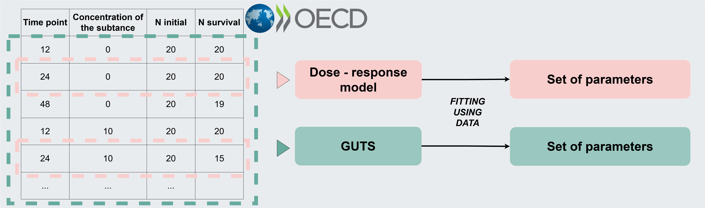
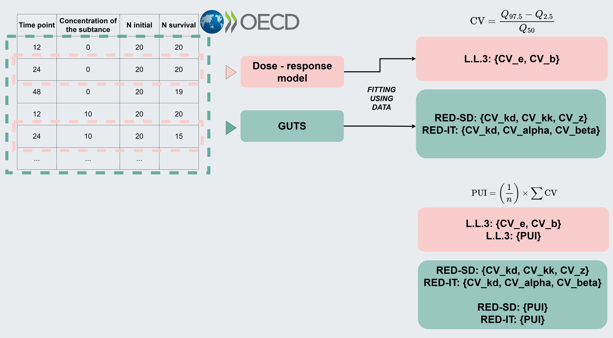

## Connecting Part 1 to Practice: Why Explainable ML as a Meta-Model? {.smaller}

Bridging Part 1's modelling epistemology to our ecotoxicological case study: operating strictly at the <strong>White Box + Grey Box</strong> intersection.

::: {.flex-row}

::: {.flex-col}
::: {.box-teal style="flex: 1;"}
**Two-Stage Meta-Modelling Architecture**

Machine learning here does **not** replace the biological model. Instead, it audits how laboratory inputs govern mechanistic inference:

- **Stage 1 — White Box Core:** Mechanistic survival models (**GUTS** and **DR**) calibrated on empirical survival data.
- **Stage 2 — Grey Box xAI Audit:** Explainable ML linking experimental design features ($X$) to parameter precision and accuracy ($Y$).
- **Deliberate Exclusion:** We avoid Deep Learning / Neural Networks, which are ill-suited to this sample regime and opaque to regulators.
:::
:::

::: {.flex-col}
::: {.box-grey style="flex: 1;"}
**Three-Point Rationale**

1. **Moderate Tabular Sample Size ($n = 216$ datasets):** Structured tabular data with low-to-moderate $n$ favour tree ensembles over deep architectures, limiting overfitting.
2. **Regulatory Auditability (EFSA / OECD):** Environmental risk assessment requires transparent, inspectable links between experimental choices and model outputs.
3. **Protocol Design, Not Black-Box Prediction:** Our goal is to derive actionable laboratory guidelines, not to deploy an unexamined predictive oracle.
:::
:::

:::

::: {.notes}
Start by tying Part 2 directly back to Part 1's framework. Emphasise for the bioinformatics and AI colleagues that choosing Random Forests over Deep Learning is a deliberate methodological choice driven by n = 216 tabular records and regulatory auditability. Make clear that ML is used as a meta-model auditing the mechanistic GUTS/DR stage—not as a replacement for biology.
:::

## From Everyday Products to Freshwater Risk: Where We Work {.smaller}

Regulatory context for non-ecotoxicologists: tracing agricultural chemical inputs to aquatic toxicity modelling.

::: {.flex-row style="min-height: 410px;"}

::: {.flex-col}
::: {.plot-placeholder}

assets/images/ws2/ws2_hook_ppp_products.png

<strong>Everyday Products to Aquatic Exposure</strong> Apple, Red Wine, Baguette $\rightarrow$ large-scale agriculture uses Plant Protection Products (PPPs) $\rightarrow$ runoff into freshwater ecosystems.

:::
:::

::: {.flex-col}
::: {.plot-placeholder}

assets/images/ws2/ws2_era_flowchart.png

<strong>EU Environmental Risk Assessment (ERA) Pipeline</strong> Problem Formulation $\rightarrow$ Exposure Assessment vs. <strong>Effect Assessment</strong> $\rightarrow$ Risk Characterisation $\rightarrow$ EU approval (e.g., Captan renewed until 2039).

:::
:::

:::

::: {.box-teal style="margin-top: 14px; margin-bottom: 0; text-align: center;"}
Our modelling work operates directly inside **Effect Assessment**: estimating how toxic a chemical is to aquatic organisms.
:::

::: {.notes}
Briefly walk the AI/bioinformatics audience through where ecotoxicological modelling sits inside European regulation. We are not estimating environmental concentrations (Exposure Assessment); we work inside Effect Assessment, estimating how sensitive aquatic organisms are to a given substance.
:::

## The Scale Crisis & The Legacy Regulatory Clash {.smaller}

::: {.flex-row}

::: {.flex-col}
::: {.box-red style="flex: 1; display: flex; flex-direction: column; margin-bottom: 0;"}
**The Scale & Ethical Bottleneck**

- $>350,000$ registered chemicals globally; $19,670$ mapped across EU frameworks; $1,474$ PPPs in the EU database.
- $440,000$–$2.2\text{ million}$ fish and birds used annually ($>\$39\text{M/yr}$; Schür et al., 2025) $\rightarrow$ ethical and economic imperative for **Predictive Ecotoxicology**.

::: {.plot-placeholder style="margin-top: 8px; min-height: 195px; padding: 10px;"}

assets/images/ws2/ws2_chemicals_scale.png

Chemical inventory scale vs. annual animal testing burden.

:::
:::
:::

::: {.flex-col}
::: {.box-teal style="flex: 1; display: flex; flex-direction: column; margin-bottom: 0;"}
**The Historical Mismatch**

- **~1980s OECD Test Guidelines:** Built for static, frequentist, fixed-time endpoints like $LC(50, 96\text{h})$ via Dose-Response (DR) models ([Daniels et al., 2026](https://doi.org/10.1093/inteam/vjaf113)).

{style="max-height: 110px; width: 100%; object-fit: contain; margin: 2px 0;"}

- **2018+ EFSA Shift:** Recommends dynamic **TKTD** mechanistic models—specifically **GUTS** (General Unified Threshold model of Survival)—for time-variable risk assessment ([EFSA, 2018](https://onlinelibrary.wiley.com/doi/abs/10.2903/j.efsa.2018.5377)).

{style="max-height: 110px; width: 100%; object-fit: contain; margin: 2px 0;"}
:::
:::

:::

::: {.notes}
Highlight two converging pressures: (1) experimental testing cannot scale to hundreds of thousands of compounds without severe ethical and financial costs (3Rs); (2) even for the tests we do run, regulatory protocols designed in the 1980s for static 96-hour endpoints are now being fed into dynamic mechanistic TKTD models (GUTS) recommended by EFSA since 2018.
:::

## Our Objective {.smaller}

::: {.center-content style="justify-content: space-evenly; padding-top: 10px;"}

{style="max-height: 300px; width: 96%; object-fit: contain;"}

::: {style="text-align: center; font-family: 'Space Grotesk', 'Segoe UI', system-ui, sans-serif; font-size: 1.95em; font-weight: 700; color: #005a8c; line-height: 1.28; max-width: 92%; margin-top: 10px;"}
How do experimental design features influence DR and GUTS parameter precision?
:::

:::

## The Empirical Landscape & Why Data Quality Comes First {.smaller}

Mapping <strong>216 time-resolved survival datasets</strong> across organisms, substances, and exposure profiles.

::: {.flex-row}

::: {.flex-col .flex-2}
{style="max-height: 500px; width: 100%; object-fit: contain;"}
:::

::: {.flex-col}
::: {.box-grey}
**Dataset Conceptualisation**

$$\mathcal{D} = (\mathbf{N}, \mathcal{E})$$

Separating raw **survival records** ($\mathbf{N}$) from structured **experimental context** ($\mathcal{E}$):

- Organism–substance **Archetype**
- **OECD** regulatory constraints
- **Mechanistic** model requirements
:::

::: {.plot-placeholder style="min-height: 215px; padding: 12px;"}

assets/images/ws2/ws2_dq_decay_example.png

<strong>Data Quality Audit Example</strong> A study labelled "constant exposure" whose measured concentration decays over time.

:::
:::

:::

::: {.notes}
Before any model fitting or ML, data curation is critical. Separating survival counts N from experimental metadata E revealed substantial discrepancies—such as studies labelled constant exposure where analytical chemistry shows rapid concentration decay. Feeding unverified labels into Stage 2 would corrupt feature importance.
:::

## Experimental Design Features (All 216 Datasets) {.smaller}

::: {.flex-row}

::: {.flex-col}
Characterising the **experimental design features** across all 216 time-resolved survival datasets.

::: {.box-grey style="margin-top: 14px;"}
**OECD TG Constraints** 
Minimum experimental criteria specified by each OECD Test Guideline corresponding to our database characteristics.
:::

::: {.box-grey style="margin-top: 10px;"}
**Mechanistic Model Requirements** 
Specific experimental design features required to ensure **identifiability** and parameter precision according to [EFSA (2018)](https://onlinelibrary.wiley.com/doi/abs/10.2903/j.efsa.2018.5377) and [Jager & Ashauer (2025)](https://leanpub.com/guts_book).
:::
:::

::: {.flex-col .flex-2 .fragment}
{style="max-height: 525px; width: 100%; object-fit: contain;"}
:::

:::

## Analytical Subset: Trout & Daphnia {.smaller}

::: {.flex-row}

::: {.flex-col}
Isolating a focused analytical subset: **Trout (*O. mykiss*)** and **Daphnia (*D. magna*)**.

::: {.box-grey style="margin-top: 14px;"}
**Why this subset?**

- Represents **~50%** of the full 216-dataset database.
- Preserves the categorical design proportions observed across all 216 datasets.
:::

::: {.fragment .box-teal style="margin-top: 10px;"}
**Next Methodological Step**

- Define a formal **precision metric** to address our objective:
  *How do **experimental design features** influence **DR and GUTS parameter precision**?*
:::
:::

::: {.flex-col .flex-2}
{style="max-height: 525px; width: 100%; object-fit: contain;"}
:::

:::

## Two-Stage Hybrid Architecture: Stage 1 $\rightarrow$ Stage 2 {.smaller}

::: {.flex-row style="gap: 12px; align-items: stretch;"}

::: {.flex-col style="flex: 1.15;"}
::: {.arch-stage .arch-stage-blue style="height: 100%;"}

Stage 1: Mechanistic CoreActive in Proof-of-Concept

<strong>GUTS-$\theta$ or DR-$\theta$</strong> fitted to survival dataset

↓

<strong>Bayesian Posterior Distribution ($\theta$)</strong>

↓

<strong>Precision Metrics: CV, PUI, (GoK)</strong> <em>"How precise are the parameters?"</em>

↓

<strong>Tabular Matrix</strong> <code>[ X: Design features | Y: Parameter Precision ]</code>

:::
:::

::: {.arch-arrow-right .fragment}
→
:::

::: {.flex-col .fragment style="flex: 0.95;"}
::: {.arch-stage .arch-stage-teal style="height: 100%; justify-content: space-between;"}

Stage 2: xAI Meta-ModelActive in Proof-of-Concept

<strong>Random Forest ($Y \sim X$)</strong> Non-linear mapping from design features to precision

↓

<strong>Feature Importance Metric (<code>%IncMSE</code>)</strong> <em>"How relevant is $X$ to predict $Y$ when non-linear relationships are involved?"</em>

:::
:::

:::

::: {.fragment style="margin-top: 10px;"}
::: {.arch-stage .arch-stage-purple}

Planned Stage 1 Extension — Additional Response Variables ($Y$) Feeding Stage 2Next Methodological Layer

::: {.flex-row style="gap: 14px;"}

<strong>Goodness-of-Fit (GoF)</strong> <em>(same dataset: MSE, RMSE, NRMSE, PPC, SPPE)</em> <em>"Does $\theta$ match training data?"</em>

<strong>Predictive Capacity</strong> <em>(unseen dataset)</em> <em>"How well does $\theta$ predict unseen data?"</em>

:::
:::
:::

::: {.box-grey style="margin-top: 10px; margin-bottom: 0; padding: 9px 14px; font-size: 0.74em;"}
<strong>Transparency Note:</strong> The empirical results shown next represent our methodological Proof-of-Concept on the active pipeline (Stage 1 Precision $\rightarrow$ Stage 2 xAI).
:::

::: {.notes}
Take time here—this slide is the structural anchor for both teams.
1. Stage 1 (blue) is our Bayesian mechanistic core: we fit DR and GUTS models to each dataset, extract posterior distributions, and summarise parameter precision (CV, PUI, and GoK). This produces a clean tabular dataset [X | Y].
2. Stage 2 (teal) fits a Random Forest (Y ~ X) and extracts %IncMSE strictly as a feature importance metric—not an accuracy metric—to see which design features govern precision under non-linear interactions.
3. Explicitly flag the purple layer as planned work: precision alone is not enough, because a model can be narrowly precise yet biased. Adding Goodness-of-Fit (on training data) and Predictive Capacity (on unseen data) will turn Y into a multi-response problem—which we will revisit in the discussion at the end.
4. Emphasise the Proof-of-Concept disclaimer: everything shown in the next slides comes from the active Precision -> xAI pipeline.
:::

## The Data Analysis $\rightarrow$ ML Bridge {.smaller}

In regulatory ecotoxicology, black-box AI faces justified skepticism. Every step toward ML must be documented.

::: {.flex-row}

::: {.flex-col .fragment style="flex: 0.34;"}
::: {.box-teal style="margin-bottom: 0;"}
[1. Descriptive]{.card-title style="font-size: 1.08em; color: #005a8c; margin-bottom: 8px;"}

Compute the **precision metrics** and visualise them by experimental design feature.
:::
:::

::: {.flex-col .fragment style="flex: 0.66;"}
{style="max-height: 495px; width: 100%; object-fit: contain;"}
:::

:::

## The Data Analysis $\rightarrow$ ML Bridge {.smaller}

In regulatory ecotoxicology, black-box AI faces justified skepticism. Every step toward ML must be documented.

::: {.flex-row}

::: {.flex-col style="flex: 0.34;"}
::: {.box-teal style="margin-bottom: 0;"}
[1. Descriptive]{.card-title style="font-size: 1.08em; color: #005a8c; margin-bottom: 8px;"}

Compute the **precision metrics** and visualise them by experimental design feature.
:::
:::

::: {.flex-col style="flex: 0.66;"}
{style="max-height: 495px; width: 100%; object-fit: contain;"}
:::

:::

## The Data Analysis $\rightarrow$ ML Bridge {.smaller}

In regulatory ecotoxicology, black-box AI faces justified skepticism. Every step toward ML must be documented.

::: {.flex-row}

::: {.flex-col style="flex: 0.34;"}
::: {.box-teal style="margin-bottom: 0;"}
[1. Descriptive]{.card-title style="font-size: 1.08em; color: #005a8c; margin-bottom: 8px;"}

Compute the **precision metrics** and visualise them by experimental design feature.
:::
:::

::: {.flex-col style="flex: 0.66;"}
{style="max-height: 495px; width: 100%; object-fit: contain;"}
:::

:::

## The Data Analysis $\rightarrow$ ML Bridge {.smaller}

In regulatory ecotoxicology, black-box AI faces justified skepticism. Every step toward ML must be documented.

::: {.flex-row}

::: {.flex-col style="flex: 0.34;"}
::: {.box-teal style="margin-bottom: 0;"}
[1. Descriptive]{.card-title style="font-size: 1.08em; color: #005a8c; margin-bottom: 8px;"}

Compute the **precision metrics** and visualise them by experimental design feature.

[1.1 Precision Metrics]{.card-title style="font-size: 1.04em; color: #005a8c; margin-top: 14px; margin-bottom: 6px;"}

- **Coefficient of Variation (CV):** Individual parameter uncertainty.
- **Parameter Uncertainty Index (PUI)** ([Bauer et al., 2024](https://academic.oup.com/etc/article/43/1/197/7728569)): Global precision metric.
:::
:::

::: {.flex-col style="flex: 0.66;"}
{style="max-height: 495px; width: 100%; object-fit: contain;"}
:::

:::

## The Data Analysis $\rightarrow$ ML Bridge {.smaller}

In regulatory ecotoxicology, black-box AI faces justified skepticism. Every step toward ML must be documented.

::: {.flex-row}

::: {.flex-col style="flex: 0.34;"}
::: {.box-teal style="margin-bottom: 0;"}
[1. Descriptive]{.card-title style="font-size: 1.08em; color: #005a8c; margin-bottom: 8px;"}

Compute the **precision metrics** and visualise them by experimental design feature.

[1.1 Precision Metrics]{.card-title style="font-size: 1.04em; color: #005a8c; margin-top: 14px; margin-bottom: 6px;"}

- **Coefficient of Variation (CV):** Individual parameter uncertainty.
- **Parameter Uncertainty Index (PUI)** ([Bauer et al., 2024](https://academic.oup.com/etc/article/43/1/197/7728569)): Global precision metric.
:::
:::

::: {.flex-col style="flex: 0.66;"}
{style="max-height: 495px; width: 100%; object-fit: contain;"}
:::

:::

## The Data Analysis $\rightarrow$ ML Bridge {.smaller}

In regulatory ecotoxicology, black-box AI faces justified skepticism. Every step toward ML must be documented.

::: {.flex-row}

::: {.flex-col style="flex: 0.34;"}
::: {.box-teal style="margin-bottom: 0;"}
[1. Descriptive]{.card-title style="font-size: 1.08em; color: #005a8c; margin-bottom: 8px;"}

Compute the **precision metrics** and visualise them by experimental design feature.

[1.1 Precision Metrics]{.card-title style="font-size: 1.04em; color: #005a8c; margin-top: 14px; margin-bottom: 6px;"}

- **Coefficient of Variation (CV):** Individual parameter uncertainty.
- **Parameter Uncertainty Index (PUI)** ([Bauer et al., 2024](https://academic.oup.com/etc/article/43/1/197/7728569)): Global precision metric.
:::
:::

::: {.flex-col style="flex: 0.66;"}
{style="max-height: 495px; width: 100%; object-fit: contain;"}
:::

:::

## Full 4-Step Documented Bridge {.smaller}

Insight 3 from Part 1 in action: exhaust classical statistical methods before invoking non-linear Machine Learning.

::: {.flex-row style="gap: 16px; margin-top: 14px;"}

::: {.flex-col .box-grey style="margin-bottom: 0;"}
[1. Descriptive]{.card-title style="font-size: 1.08em; color: #212529; margin-bottom: 8px;"}

Compute precision metrics (`CV`, `PUI`) and visualise them across design features.

[Metrics]{.card-title style="font-size: 0.96em; color: #495057; margin-top: 18px; margin-bottom: 6px;"}

- **CV:** Individual parameter uncertainty.
- **PUI** ([Bauer et al., 2024](https://academic.oup.com/etc/article/43/1/197/7728569)): Global parameter precision.
:::

::: {.flex-col .box-grey style="margin-bottom: 0;"}
[2. Univariate]{.card-title style="font-size: 1.08em; color: #212529; margin-bottom: 8px;"}

Test 1-vs-1 monotonic relationships between design features and precision.

[Method]{.card-title style="font-size: 0.96em; color: #495057; margin-top: 18px; margin-bottom: 6px;"}

- **Spearman coefficient** across experimental design features and precision metrics.
:::

::: {.flex-col .fragment .box-grey style="margin-bottom: 0;"}
[3. Multivariate]{.card-title style="font-size: 1.08em; color: #212529; margin-bottom: 8px;"}

Quantify how much variance is captured by linear multivariate combinations.

[Method]{.card-title style="font-size: 0.96em; color: #495057; margin-top: 18px; margin-bottom: 6px;"}

- **Redundancy Analysis (RDA)** relating design features to precision metrics.
:::

::: {.flex-col .fragment .box-teal style="margin-bottom: 0;"}
[4. ML Audit]{.card-title style="font-size: 1.08em; color: #005a8c; margin-bottom: 8px;"}

Capture non-linear relationships and feature interactions.

[Method]{.card-title style="font-size: 0.96em; color: #005a8c; margin-top: 18px; margin-bottom: 6px;"}

- **Random Forest** ($Y \sim X$) predicting precision metrics from design features.
:::

:::

::: {.notes}
This four-step ladder operationalises Insight 3 from Part 1: we do not jump straight to ML. We systematically document what descriptive summaries, rank correlations (Spearman), and linear multivariate models (RDA) can and cannot explain before invoking Random Forests.
:::

## Step 1 (Descriptive): The Feature Translation Matrix {.smaller}

::: {.flex-row}

::: {.flex-col .fragment}
**The Feature Translation Matrix**

We translated binary OECD and mechanistic rules into continuous numerical gradients.

<table style="width: 100%; font-size: 0.85em; border-collapse: collapse; margin-top: 12px;">
<thead>
<tr style="border-bottom: 2px solid #005a8c;">
<th style="padding: 8px; text-align: left;">Binary Rule</th>
<th style="padding: 8px; text-align: left;">Continuous Feature</th>
</tr>
</thead>
<tbody>
<tr>
<td style="padding: 8px;">Max Spacing</td>
<td style="padding: 8px; color: #005a8c; font-family: monospace;">actual_max_spacing</td>
</tr>
<tr>
<td style="padding: 8px;">Min 5 Timepts</td>
<td style="padding: 8px; color: #005a8c; font-family: monospace;">num_timepoints</td>
</tr>
<tr>
<td style="padding: 8px;">Effect Range</td>
<td style="padding: 8px; color: #005a8c; font-family: monospace;">max_mortality_delta &amp; partial_effect_concs</td>
</tr>
<tr style="border-bottom: 2px solid #005a8c;">
<td style="padding: 8px;">Extended Duration</td>
<td style="padding: 8px; color: #005a8c; font-family: monospace;">extended_hours</td>
</tr>
</tbody>
</table>
:::

::: {.flex-col .flex-2}
{style="max-height: 520px; width: 100%; object-fit: contain;"}
:::

:::

## Step 1 (Descriptive): Effect Range vs. PUI {.smaller}

::: {.flex-row}

::: {.flex-col}
**The Feature Translation Matrix**

Focusing on **Effect Range** features against global parameter precision (`PUI`).

<table style="width: 100%; font-size: 0.85em; border-collapse: collapse; margin-top: 12px;">
<thead>
<tr style="border-bottom: 2px solid #005a8c;">
<th style="padding: 8px; text-align: left;">Binary Rule</th>
<th style="padding: 8px; text-align: left;">Continuous Feature</th>
</tr>
</thead>
<tbody>
<tr style="opacity: 0.3;">
<td style="padding: 8px;">Max Spacing</td>
<td style="padding: 8px; color: #005a8c; font-family: monospace;">actual_max_spacing</td>
</tr>
<tr style="opacity: 0.3;">
<td style="padding: 8px;">Min 5 Timepts</td>
<td style="padding: 8px; color: #005a8c; font-family: monospace;">num_timepoints</td>
</tr>
<tr>
<td style="padding: 8px; font-weight: 700;">Effect Range</td>
<td style="padding: 8px; color: #005a8c; font-family: monospace; font-weight: 700;">max_mortality_delta &amp; partial_effect_concs</td>
</tr>
<tr style="opacity: 0.3; border-bottom: 2px solid #005a8c;">
<td style="padding: 8px;">Extended Duration</td>
<td style="padding: 8px; color: #005a8c; font-family: monospace;">extended_hours</td>
</tr>
</tbody>
</table>
:::

::: {.flex-col .flex-2}
{style="max-height: 520px; width: 100%; object-fit: contain;"}
:::

:::

## Steps 2 & 3 (Univariate & Multivariate): Hitting the Linear Ceiling {.smaller}

::: {.flex-row}

::: {.flex-col}
::: {.box-grey style="margin-top: 12px;"}
- **Spearman correlations:** Distinct, weak, or scattered signals across individual parameters and experimental design features.
- **Redundancy Analysis (RDA):** Linear multivariate modelling explains a maximum of **~25%** of total variance across models.
:::

::: {.fragment .box-teal style="margin-top: 10px;"}
Classical linear tools are exhausted $\rightarrow$ empirically justifying **Stage 2 (non-linear ML)**.
:::
:::

::: {.flex-col .flex-2}
{style="max-height: 515px; width: 100%; object-fit: contain;"}
:::

:::

::: {.notes}
Point out that Spearman correlations reveal isolated parameter-specific trends, while Redundancy Analysis tops out at roughly 25% of explained variance. That empirical ceiling—not novelty—is what justifies stepping into Random Forests in Stage 2.
:::

## Step 4 (ML Audit): Random Forest Feature Importance (`%IncMSE`) {.smaller}

::: {.flex-row}

::: {.flex-col style="flex: 1.05;"}
::: {style="font-size: 0.78em; margin-top: -4px; margin-bottom: 8px;"}
$$\%\text{IncMSE} = \frac{\text{MSE}_{\text{permuted}} - \text{MSE}_{\text{base}}}{\text{MSE}_{\text{base}}} \times 100$$
:::

::: {.box-teal style="padding: 10px 14px; font-size: 0.76em; margin-bottom: 10px;"}
**`%IncMSE` (Percentage Increase in Mean Squared Error)** is a **feature importance metric**: a high value means Random Forest predictions of parameter precision became **less accurate** when that design feature was randomly permuted.
:::

::: {.fragment .box-grey style="padding: 10px 14px; font-size: 0.76em; margin-bottom: 10px;"}
- **Maximum Mortality Delta** and **Number of time points** are almost equally relevant across all three models.
- **DR** precision is heavily driven by capturing **Partial Effect Concentrations**.
:::

::: {.box-grey style="padding: 8px 12px; font-size: 0.68em; margin-bottom: 0; color: #495057;"}
**Model sanity check (OOB $R^2$ on global `PUI`, $n = 112\text{--}114$):** 
GUTS-IT: **68.4%** | DR: **40.6%** | GUTS-SD: **24.5%** 
*(Confirms real non-linear signal behind `%IncMSE` on `PUI`; individual `cv_*` ratios exhibit numerical instability near $\log_{10}(\theta)\approx 0$.)*
:::
:::

::: {.flex-col .flex-2 style="flex: 1.55;"}
{style="max-height: 515px; width: 100%; object-fit: contain;"}
:::

:::

::: {.notes}
Be explicit about two methodological safeguards:
1. %IncMSE stands for Percentage Increase in Mean Squared Error and is a permutation-based feature importance metric, NOT a standalone accuracy metric.
2. Before interpreting %IncMSE rankings, we audited Out-Of-Bag (OOB) predictive performance so we do not interpret noise. On the global precision index (PUI), OOB R-squared reaches 68.4% for GUTS-IT, 40.6% for DR, and 24.5% for GUTS-SD (n = 112–114), confirming genuine signal.
3. Auditing OOB R-squared on individual parameter CVs also caught a mathematical artifact: dividing log10 interval width by |log10(median)| explodes whenever a parameter median is close to 1 (log10 ≈ 0), producing extreme outliers (up to 316x the median) and negative OOB R-squared. For the next iteration, individual parameters will use direct log10 widths or GoK instead of this ratio.
:::

## Applying the Insight: Why Historical Data Are Not Enough {.smaller}

::: {.flex-row}

::: {.flex-col}
::: {.box-grey style="margin-top: 10px;"}
**Recap from Stage 2 Audit**

**Maximum Mortality Delta** and **Number of time points** co-drive parameter precision across models.
:::

::: {.fragment .box-red style="margin-top: 10px;"}
**Structural Limitations of Retrospective Data**

- Historical datasets leave large gaps in the experimental design space (heavily biased toward legacy OECD protocols).
- The relationship is non-linear and multidimensional—we cannot yet extract robust numeric thresholds.
- **Open regulatory question:** *If a laboratory design inflates parameter uncertainty (high PUI), how severely does it degrade the final $LC_{50}$?*
:::
:::

::: {.flex-col .flex-2}
{style="max-height: 515px; width: 100%; object-fit: contain;"}
:::

:::

::: {.notes}
Use the response surface on the right to illustrate sampling sparsity: because historical studies cluster around legacy OECD protocols, large regions of the design space remain empty. Retrospective ML tells us which variables matter, but cannot safely extrapolate thresholds into untested protocol designs.
:::

## Next Step: From Retrospective Audit to Prospective Simulation {.smaller}

::: {.plot-placeholder style="min-height: 310px; margin-bottom: 14px;"}

assets/images/ws2/ws2_prospective_workflow.png

<strong>Prospective Simulation &amp; Validation Pipeline</strong> Empirical Archetypes (organism–substance parameter distributions) $\rightarrow$ Synthetic Experimental Scenarios (Poor / Regulatory / Model-Guided) $\rightarrow$ Forward GUTS/DR Simulation &amp; Refitting $\rightarrow$ ML Meta-Model Training $\rightarrow$ Validation via Data Thinning.

:::

::: {.flex-row style="gap: 18px;"}

::: {.flex-col .box-teal style="margin-bottom: 0;"}
**Immediate Goal** 
Move from identifying *which* features matter to quantifying **actionable design thresholds** that balance statistical precision with the 3Rs.
:::

::: {.flex-col .box-grey style="margin-bottom: 0;"}
**Longer-Term Thesis Horizon** 
Once reliable model-guided designs are validated, extend the GUTS framework to combined **chemical + climate-change stressors**.
:::

:::

::: {.notes}
Explain the functional transition: Retrospective Audit exposed what matters and where historical data are blind; Prospective Simulation uses empirical organism–substance archetypes to systematically generate synthetic protocols, refit GUTS/DR, and validate model-guided designs via data thinning on dense empirical curves. Once validated, this design foundation supports multi-stressor (chemical + climate) extensions.
:::

## Take-Home Messages {.smaller}

::: {.flex-row style="min-height: 460px; align-items: stretch;"}

::: {.flex-col .flex-2 style="justify-content: center; padding-right: 18px;"}
<ol style="font-size: 1.08em; line-height: 1.65;">
<li class="fragment" style="margin-bottom: 18px;"><strong>The Legacy Mismatch:</strong> Standardised <strong>OECD experimental designs are</strong> not optimised for dynamic mechanistic models like GUTS.</li>
<li class="fragment" style="margin-bottom: 18px;"><strong>Justified, Explainable ML:</strong> Pairing a mechanistic White Box with an interpretable Grey Box meta-model—only after exhausting classical statistics—preserves regulatory auditability.</li>
<li class="fragment" style="margin-bottom: 0;"><strong>Audit Before Simulation:</strong> Retrospective ML shows <em>what</em> drives precision and exposes historical data gaps, justifying targeted synthetic simulations.</li>
</ol>
:::

::: {.flex-col style="border-left: 2px dashed #ced4da; padding-left: 26px; justify-content: center;"}
::: {.plot-placeholder style="min-height: 310px;"}

assets/images/ws2/ws2_repo_qr.png

<strong>Workshop Website &amp; Open Materials</strong> QR code &amp; repository link

:::
:::

:::

::: {.notes}
Summarise the three core points cleanly, then move straight to Slide 23 to open the 15-minute inter-team discussion between ecotoxicologists and bioinformatics/AI researchers.
:::

## Open Methodological Challenges: Ecotox $\leftrightarrow$ AI/Bioinformatics Discussion {.smaller}

Moving from our current Proof-of-Concept to the extended Stage 1 + Stage 2 pipeline—your input is welcome.

::: {.flex-row style="gap: 18px; margin-top: 14px; min-height: 430px;"}

::: {.flex-col .box-purple style="margin-bottom: 0; justify-content: flex-start;"}
[1. Multi-Response Learning]{.card-title style="font-size: 1.08em; color: #7b1fa2; margin-bottom: 12px;"}

Adding **Goodness-of-Fit (GoF)** and **Predictive Capacity** alongside **Precision** (`CV`, `PUI`, `GoK`) yields correlated targets $Y$.

With $n \approx 200$ and collinear design features $X$, should we move to **multi-output algorithms** (e.g., Multivariate Random Forests) or keep separate single-target models?
:::

::: {.flex-col .box-teal style="margin-bottom: 0; justify-content: flex-start;"}
[2. Leakage-Free Data Splitting]{.card-title style="font-size: 1.08em; color: #005a8c; margin-bottom: 12px;"}

To evaluate GUTS **Predictive Capacity** on unseen data without data leakage across shared species, chemicals, or source studies:

How should we structure **grouped / stratified splits** on an unbalanced ecotoxicological database?
:::

::: {.flex-col .box-grey style="margin-bottom: 0; justify-content: flex-start;"}
[3. Efficient Optimization Under 3Rs Constraints]{.card-title style="font-size: 1.08em; color: #212529; margin-bottom: 12px;"}

In the prospective simulation phase, running Bayesian GUTS calibration across thousands of candidate designs is computationally heavy.

Could **surrogate models + Active Learning / Bayesian Optimization** guide the search under ethical and budget constraints?
:::

:::

::: {.notes}
Leave this slide on screen for the 15-minute open discussion. Prompt both groups specifically:
- Question 1 (AI / Stats): Trade-offs between Multivariate RF / multi-task models vs. separate single-output RFs when n ~ 200 and targets (Precision, GoF, Predictive Capacity) are correlated. Also ask about handling collinearity in permutation importance (e.g., conditional permutation importance or SHAP).
- Question 2 (Ecotox + AI): What defines a truly independent test split—holding out a study, a chemical, or a species-chemical pair—and how to avoid collapsing sample size in sparse taxa?
- Question 3 (AI + Ecotox): Using emulators/surrogates and Bayesian Optimization to search the protocol space under hard 3Rs constraints (maximum animals, minimum timepoints) instead of brute-force grid MCMC calibration.
:::

## {.no-logos background-color="#005a8c"}

::: {.center-content style="color: #ffffff; justify-content: center; gap: 36px;"}

Thank you &amp; Questions

FR BioEEnViS Knowledge-Sharing Seminar · LBBE / INRAE · December 16, 2026

assets/images/logos/BIOEENVIS_LOGO.png

FR BioEEnViS Logo

:::

::: {.footer}
[Built with [Quarto](https://quarto.org)]{style="color: #e9ecef;"}
:::